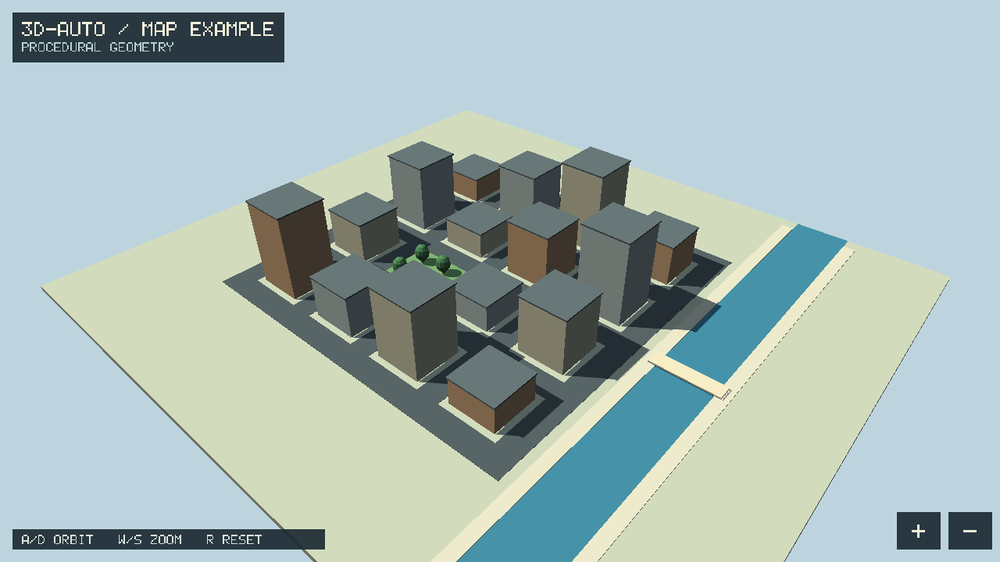

# 3D-auto

[](https://github.com/olivermikkola/3D-auto/actions/workflows/ci.yml)

A small 3D engine in Rust with Lua scripting. It renders low-poly meshes,
simulates rigid bodies, mixes sound and forwards keyboard, mouse, touch and
gamepad input. Applications supply their own scripts and assets.

The included example is a fictional map: streets, buildings, a park and a
canal. It demonstrates the engine without missions, characters or game assets.



## Run

```sh
cargo run --release
cargo run --release -- path/to/your_scene
```

The default scene lives in `game/` for compatibility with existing launchers.
It is a standalone map example; edit `game/maps/example.lua` to change its
layout. Left/right or A/D orbit, up/down or W/S zoom, and R resets the view.
On touch screens, drag to orbit and use the + / - buttons to zoom.
F5 reloads scripts. Escape exits. The example uses no downloaded map data.

## Build and verify

```sh
cargo fmt --check
cargo clippy --release -- -D warnings
cargo test --release
cargo build --release
python3 tools/check_demo.py
```

For a real rendered screenshot on Linux with software GL:

```sh
LIBGL_ALWAYS_SOFTWARE=1 xvfb-run -a target/release/auto game --frames 4 --screenshot map.ppm
```

`web/build.sh` builds the same example for WebAssembly. See
[web/README.md](web/README.md). CI verifies the native scene and browser build.

## Build your own scene

Put a `main.lua` in a directory and pass that directory to `auto`. Subscribe to
engine events, spawn meshes and set a camera. [The Lua API](docs/API.md)
describes the bindings. The engine is independent of the bundled example.

```lua
engine.on("init", function()
  engine.spawn{mesh="cube", pos={0, 1, 0}, size={2, 2, 2}, color={0.5, 0.7, 0.8}}
end)
engine.on("frame", function()
  engine.camera(8, 6, 8, 0, 0, 0)
end)
```

The binary supports `--headless TICKS`, `--frames N`, `--screenshot OUT.ppm`,
`--record OUT.rgb`, `--ticks-per-frame N`, `--size WxH`, `--save-dir DIR`,
`--fps N` and `--fullscreen`. Run `auto --help` for syntax.

## Repository scope

This repository contains the reusable engine, browser runtime and generic
example. Application-specific gameplay, maps, artwork and tests have moved
to a separate repository. Historical branches, tags and releases retain their
original contents and licenses. The split changes current source, not history.

## License

MIT; see [LICENSE](LICENSE). Vendored Lua retains its own notices under
`web/lua-src/`. The example uses procedural geometry and shares the MIT license.
