# auto

[](https://github.com/olivermikkola/3D-auto/actions/workflows/ci.yml)
[](https://github.com/olivermikkola/3D-auto/releases)
[](LICENSE)

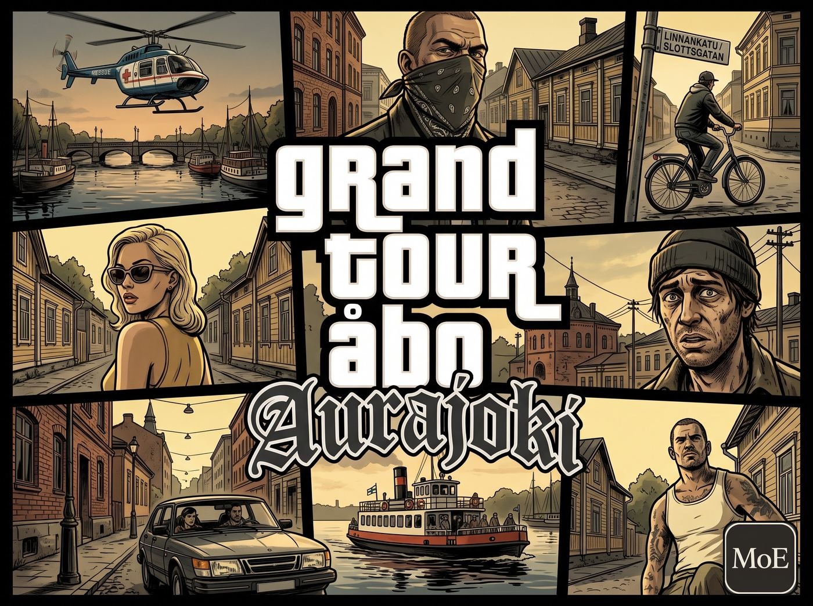

A minimal 3D sandbox kernel in Rust. One ~1 MB binary renders low-poly meshes with shadows
and dynamic lights, runs rigid-body physics, mixes sound, and forwards input. **The game is entirely Lua**: the binary emits events
into a tiny pub/sub bus, and scripts build the world on top of it.

The bundled `game/` directory is an open-city demo in about 1,000 lines of Lua. It has a
procedural island city laid out like Manhattan (long blocks between wide avenues, Central Park,
a skyline that peaks in Midtown and the Financial District, brownstones uptown) with an Art Deco
tower, a TV tower and a car park you can drive to the top of, drivable cars that can jump and
roll, a stunt park, on-foot movement,
ambient traffic, pedestrians, weapons, health and exploding cars, a wanted level with police
pursuits and shootouts, a day/night cycle, synthesized sound, a minimap, cash, seven missions,
progress that's saved between sessions, a pause menu with settings, and shops to spend your
cash in. Edit any `.lua` file while it runs and it hot-reloads.

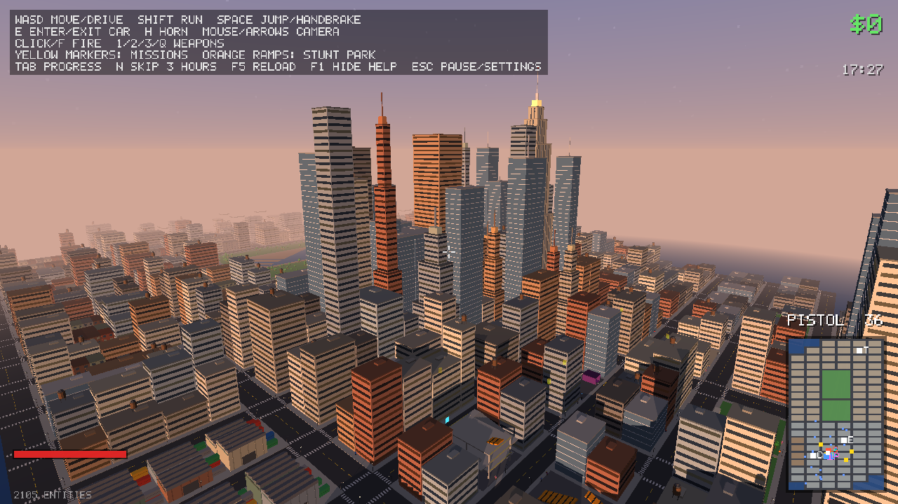

**Download:** builds for Linux, Windows and macOS are on the
[Releases](https://github.com/olivermikkola/3D-auto/releases) page. Unzip and run `auto`. On
macOS the build isn't signed, so right-click the binary and choose Open the first time.

**From source:**

```
cargo run --release              # runs ./game
cargo run --release -- my_game   # any directory with a main.lua
```

Controls: `WASD` move/drive · `Shift` run · `Space` jump/handbrake · `E` enter/exit car · `H` horn · click or `F` fire · `1`/`2`/`3`/`Q` weapons · `N` skip 3 hours · `Tab` progress · `R` shops and the garage ·
mouse or arrow keys for the camera · `F5` reload · `F1` help · `Esc` pause and settings.
A gamepad works too (see [Gamepads](#gamepads)), and so does a touch screen in the browser build (see `web/README.md`).

## Design

| Piece | Lines | Notes |
|---|---|---|
| `src/math.rs` | ~250 | `Vec3`, `Quat`, column-major `Mat4`. Y up, right-handed. |
| `src/mesh.rs` | ~250 | Flat-shaded unit primitives, OBJ+MTL loader, part baking. |
| `src/physics.rs` | ~1200 | Oriented boxes: SAT, corner contacts, warm-started sequential impulses, a grid broad phase, rays along it; heightfield terrain. |
| `src/audio.rs` | ~530 | Mixer with pitch and 3D panning, synth, WAV loader, output backends. |
| `src/render.rs` | ~620 | miniquad/GL: sun shadow map, sky, lit pass with 16 lights, emissive, fog, HUD. |
| `src/script.rs` | ~740 | The `engine` Lua table and the event bus. |
| `src/save.rs` | ~570 | Save data: Lua values to readable files and back, parsed as data and never run. |
| `src/main.rs` | ~540 | Fixed 60 Hz tick, input, hot reload, headless + screenshot modes. |
| `src/pad.rs` | ~480 | Gamepads: evdev read directly on Linux, gilrs elsewhere. |

Choices made to keep it small:

- **No ECS and no scene graph.** An entity is a position, yaw, scale, mesh, color, an optional
  body, and a tag. Lua holds plain integer ids.
- **Physics is boxes, but real ones.** Every body is an oriented box with mass and inertia.
  The separating axis test finds the normal, penetrating corners are the contacts, and
  sequential impulses with warm starting (so stacks rest) give linear and angular response.
  Cars roll, crates tumble, and a tilted static box is a ramp. No meshes collide, only boxes.
- **Sound is synthesized.** `engine.synth` renders sfxr-style effects at load, so the demo
  ships no audio files. On Linux, ALSA is `dlopen`ed (no build dependencies); elsewhere
  it's `cpal`. With no device the game runs silently.
- **Prefabs are baked.** `engine.mesh(name, parts)` merges primitives into one mesh, so a car
  costs one draw call.
- **Missions are coroutines.** A mission reads top to bottom: `m:wait(...)`, `m:timer(...)`.
- **Deterministic headless mode.** `--headless N` runs N ticks with no window. CI uses it to
  play the game through scripted input (`game/test/autoplay.lua`).

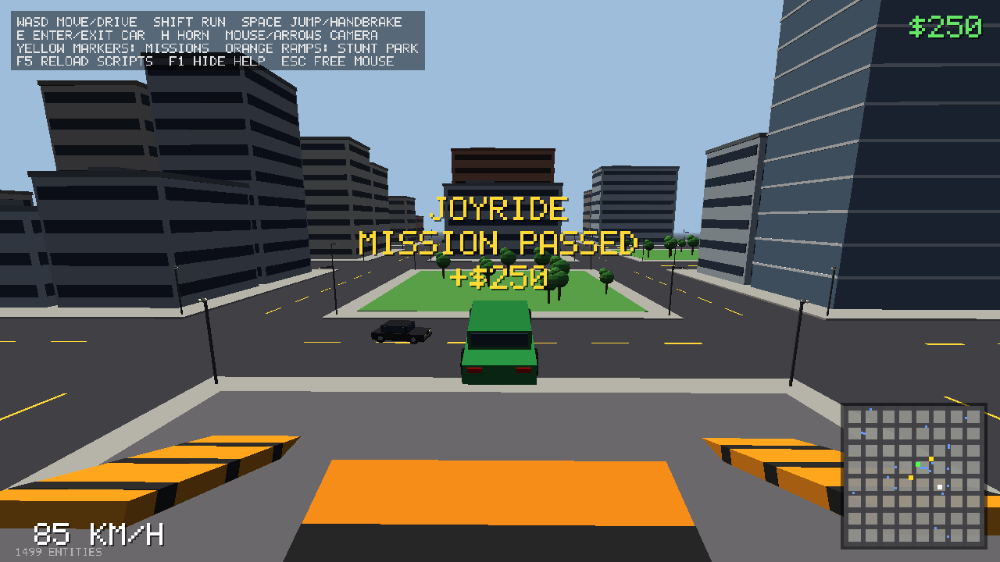

## The event bus

The engine only ever calls `engine.emit(event, ...)`:

| Event | Args | When |
|---|---|---|
| `init` | | after `main.lua` runs |
| `tick` | `dt` | fixed 60 Hz, before physics |
| `contact` | `a, b, speed` | each touching body pair after physics; `speed` = impact speed in m/s |
| `frame` | `dt` | once per rendered frame; build the HUD and camera here. `dt` is 0 while paused |
| `key` | `name, down` | keys: `a`-`z`, `0`-`9`, `space`, `shift`, `up`, `f1`, `mouse1`, ..., and gamepad buttons `pad_a`, `pad_b`, `pad_x`, `pad_y`, `pad_lb`, `pad_rb`, `pad_lt`, `pad_rt`, `pad_back`, `pad_start`, `pad_l3`, `pad_r3`, `pad_up`/`down`/`left`/`right` |
| `pad_connected` / `pad_disconnected` | `name` | a gamepad was plugged in or pulled out |
| `touch` | `phase, id, x, y` | a finger on a touch screen: `phase` is `start`, `move`, `end` or `cancel`, `x, y` in pixels; `lib/touch.lua` turns them into a gamepad |
| `quit` | | before the game closes, and before a hot reload replaces the scripts; save here |
| `menu_key` | `name, down` | instead of `key` while the game is paused, so only menus see input |
| `minimized` | | the window was minimized (the demo pauses) |

Scripts subscribe with `engine.on(ev, fn)`, `engine.once`, `engine.off`, and can emit their
own events. The demo's own events include `vehicle_enter`, `carjacked`, `ped_down`, `damaged`,
`killed`, `gunshot`, `explosion`, `player_hurt`, `wasted`, `respawned`, `pickup`, `wanted_changed`,
`busted`, `mission_passed`, `stunt`, `purchase`, `resprayed`, `car_bought`, and `minimap` (other systems draw blips with it). A handler that
throws is reported on screen with a traceback, and the other handlers still run.

## Lua API

```lua
-- entities
id = engine.spawn{mesh="cube", pos={x,y,z}, size={w,h,d}, scale=..., yaw=0, pitch=0, roll=0,
                  color={r,g,b,a}, tag="crate", visible=true,
                  body="static"|"dynamic"|"kinematic", mass=1, friction=0.6,
                  restitution=0, gravity=1, sensor=false, step=0, lock_rotation=false}
engine.despawn(id)          engine.exists(id)
engine.pos(id) -> x,y,z     engine.set_pos(id, x,y,z)
engine.yaw(id)              engine.set_yaw(id, radians)   -- heading; keeps pitch and roll
engine.orient(id, yaw[, pitch[, roll]])                   engine.rot(id) / set_rot(id, x,y,z,w)
engine.forward(id) / up(id) / right(id) -> x,y,z          -- local +Z, +Y, -X in world space
engine.vel(id) -> x,y,z     engine.set_vel(id, x,y,z)
engine.angvel(id) -> x,y,z  engine.set_angvel(id, x,y,z)  -- rad/s, world space
engine.push(id, ix,iy,iz[, px,py,pz])                     -- impulse, optionally at a point
engine.grounded(id)         engine.tag(id)                engine.find(tag) -> {ids}
engine.set_mesh(id, name)  engine.mesh_of(id) -> name
engine.set_color(id, r,g,b[,a])   engine.set_visible(id, bool)   engine.set_scale(id, s)
engine.set_glow(id, g)          -- self-illumination regardless of time of day (spawn{glow=} too)
engine.nearest(x,y,z, radius[, tag[, ignore]]) -> id, dist
engine.raycast(ox,oy,oz, dx,dy,dz[, max[, ignore]]) -> id, dist, hx,hy,hz, nx,ny,nz

-- meshes (builtin unit shapes: cube wedge cylinder sphere plane)
engine.mesh(name, {{mesh="cube", pos=..., size=..., yaw=..., color=..., axis="x", emissive=0}, ...})
-- a part can be a footprint pushed up instead: walls round it from pos up `height`, a flat roof
engine.mesh(name, {{outline={x,z, x,z, ...}, height=12, pos=..., yaw=..., color=...}, ...})
engine.load_obj(name, "assets/thing.obj")      -- usemtl Kd = color, Ke = glows at night

-- lighting (lights and emissive parts are scaled by glow: 0 by day, 1 at night)
engine.lighting{sky={r,g,b}, sky_top=, sun={x,y,z}, sun_color=, ambient=, ground=, glow=0..1, shadows=true}
id = engine.light{pos={x,y,z}, dir={x,y,z}, color=, intensity=1, radius=12, cone=180, follow=entity}
engine.set_light(id, {...})  engine.remove_light(id)  -- cone = half-angle in degrees (180 = point)

-- sound (mono, 44.1 kHz; voices with pos/follow are panned and attenuated from the camera)
engine.synth(name, {wave="square"|"saw"|"sine"|"triangle"|"noise", freq=440, freq_end=,
                    dur=0.3, attack=, release=, volume=0.5, lowpass=1, notes={...}, note_len=, loop=false})
engine.load_wav(name, "assets/boom.wav")                  -- 8/16-bit PCM, any rate
voice = engine.play(name[, {volume=1, pitch=1, loop=false, pos={x,y,z}, follow=id, ui=false}])  -- ui: plays while paused
engine.set_voice(voice, {volume=, pitch=, pos=})  engine.stop(voice)  engine.playing(voice)
engine.volume([master]) -> master

-- world
engine.terrain{x0=, z0=, step=, w=, d=, heights={w*d, row by row toward +z}, colors={r,g,b per height},
               roads={ax,az,ay, bx,bz,by, half width, road number, asphalt half width,
                      side 1 raised (0/1), side 2 raised, ...}, kerb=meters}  -- roads: see "Terrain"
engine.terrain(nil)                            -- the ground as a heightfield; nil removes it
engine.terrain_height(x, z) -> h, nx,ny,nz     -- nothing off the grid
engine.camera(ex,ey,ez, tx,ty,tz[, fov_deg])  engine.camera_pos() -> x,y,z
engine.sky(r,g,b)  engine.fog(start, end)  engine.sun(x,y,z)  engine.gravity(g)  -- shorthands

-- input & HUD (pixels, origin top-left)
engine.key(name)  engine.mouse() -> dx,dy  engine.grab_mouse(bool)  engine.screen() -> w,h
engine.cursor() -> x,y      -- mouse position in pixels, for clicking on menus
engine.pad() -> {name, lx, ly, rx, ry, lt, rt} | nil   -- sticks -1..1 (up/right +), triggers 0..1
engine.pause(bool)  engine.paused()   engine.fullscreen([bool]) -> bool
engine.rect(x,y,w,h, r,g,b[,a])  engine.text(str, x,y[, size[, r,g,b,a]])  engine.text_width(str[, size])

-- saves (one plain value per key: tables, strings, numbers, booleans; see "Saves")
engine.save(key, value) -> true | nil, err     -- value nil deletes the key
engine.load(key) -> value | nil[, err]         engine.saves() -> {keys}

-- misc
engine.time()  engine.ticks()  engine.stats()  engine.files(dir)  engine.dirs(dir)  engine.quit()
engine.reload()                                -- start the scripts afresh after this frame, as F5 does
engine.load_mods(folder)  engine.load_mod(folder)        -- sandboxed; see MODDING.md
```

## Terrain

`engine.terrain` takes the ground as a grid of heights. Each cell is two triangles, split the same
way for drawing and for collisions, so what you see is what you drive on. It's drawn in chunks of
64 × 64 cells (tag `terrain_mesh`), colored per height point if `colors` is given. Moving boxes
collide with it corner by corner: each corner below the surface gets a contact pushing out along
the surface's normal there, through the same solver as box-on-box contacts, so cars drive up
hills and crates rest on slopes or slide off steep ones. Rays stop at it (it answers to tag
`terrain`), and `engine.terrain_height` gives the height and normal anywhere on it.
`TERRAIN_TEST=1` builds a 10 m hill past the edge of town and checks all of that, a car included.

`roads` lays roads over the grid as pieces of centerline with a height at each end, level across
out to `half width`. On a road the surface is the road's own, smooth along it, instead of the
grid's triangles (which crease every 10 m wherever a road curves or climbs); just past its edge it
eases back to the grid over 2 m. A point beside two pieces of the same road (inside a bend) takes
both, and where different roads overlap, around junctions, they're averaged, nearer centerlines
counting more, so the surface leans from one to the other without a step. Collisions, rays and
`engine.terrain_height` all see the roads. The drawn grid stays under them, except where a road runs
below it (in a sag, or down into a tunnel): there the grid comes down to meet the road.

Past `asphalt half width`, a side marked raised (a pavement or a median) stands `kerb` meters
higher, out to `half width`. Side 1 is toward (dz, -dx), (dx, dz) being the piece's direction. A
point on any road's asphalt is never raised, so where one road's pavement meets a side street,
the side street wins.

## Lighting and day/night

The renderer draws, per frame:

- **Shadow map:** the sun's view of a 170 m box in front of the camera. Depth is packed into an
  RGBA8 texture so it runs on any GL2/GLES2 driver, and the box is snapped to whole texels so
  shadow edges don't shimmer.
- **Sky:** a gradient with a sun or moon disc, and stars as it gets dark.
- **Lit pass:** sun with 3×3 PCF shadows, hemisphere ambient, the 16 nearest point/spot lights,
  emissive surfaces, and fog.

All of it is driven from Lua. `lib/daynight.lua` (~60 lines) moves the sun, blends day, dusk
and night palettes, and sets `glow`. Glow turns on emissive mesh parts (headlights, taillights,
lamp bulbs, a third of the office floors) and scales every light. Street lamps and headlights
are ordinary `engine.light`s that follow their entity, so the engine moves them; Lua never
touches them per frame. A full day lasts 48 minutes; N skips 3 hours. `HOUR=22 auto game` starts at night.

| | |
|---|---|
| 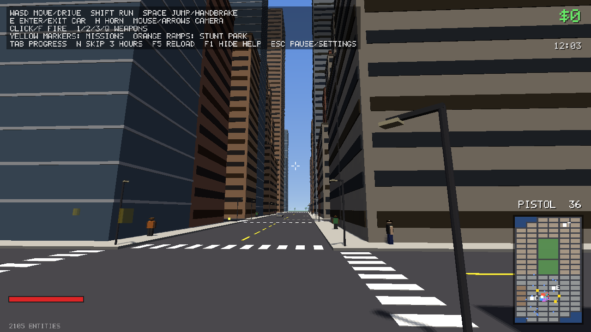 | 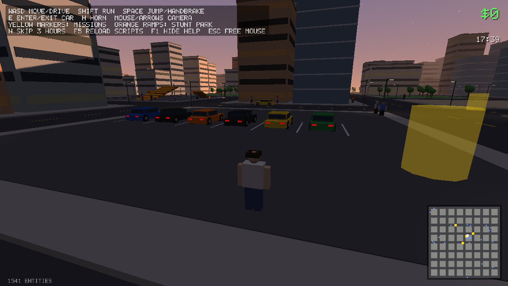 |

## Gamepads

Plug in a controller and play; the help overlay switches to show its buttons.

| | on foot | driving |
|---|---|---|
| left stick | move (analog: a light push walks slowly) | steer (analog) |
| right stick | camera | camera |
| RT | fire | accelerate (analog) |
| LT | | brake, then reverse (analog) |
| A | jump | handbrake |
| B | run | horn |
| Y | get in a car | get out |
| X | use a shop | use the spray shop or garage |
| LB / RB | previous / next weapon | |
| Back / Start | progress / pause | |

In menus, the D-pad or left stick moves, A picks and B goes back. Pulling the controller out
pauses the game.

The engine turns buttons into ordinary key names (`pad_a`, `pad_start`, ...), so they arrive as
`key` events, `engine.key("pad_a")` works, and while paused they go to `menu_key` like
everything else. `engine.pad()` gives the sticks and triggers. `lib/input.lua` (~110 lines)
merges keyboard and pad into analog move, drive and look values and maps the buttons onto the
keys the game already used, so no other system had to change.

On Linux, `src/pad.rs` reads `/dev/input/event*` directly through the kernel's gamepad API, so
there's still no build dependency (no libudev); any controller whose driver follows that API
(Xbox, PlayStation, Switch Pro and most others) works, and it notices pads plugged in later. On
Windows and macOS it uses [gilrs](https://crates.io/crates/gilrs). The analog settings (mouse
sensitivity, invert camera Y) apply to the right stick too.

## The city

| | |
|---|---|
| 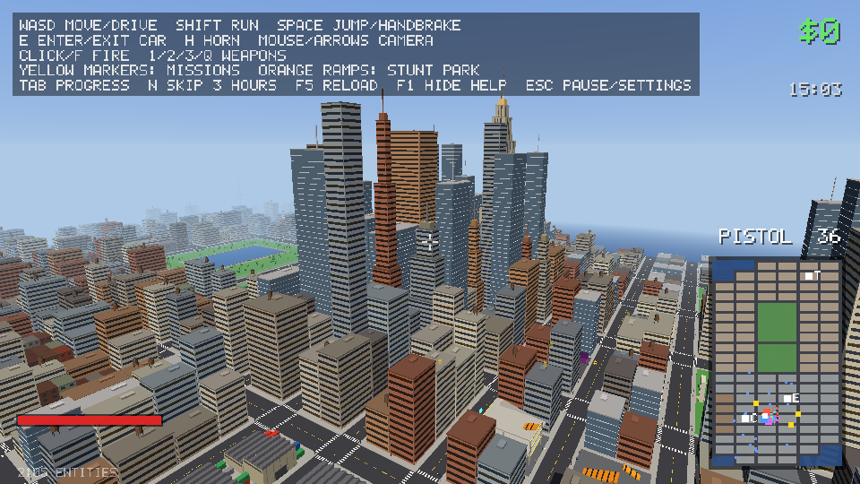 | 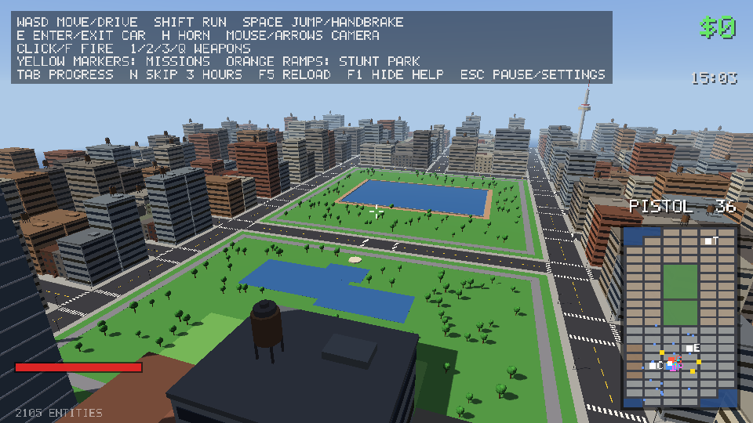 |
| 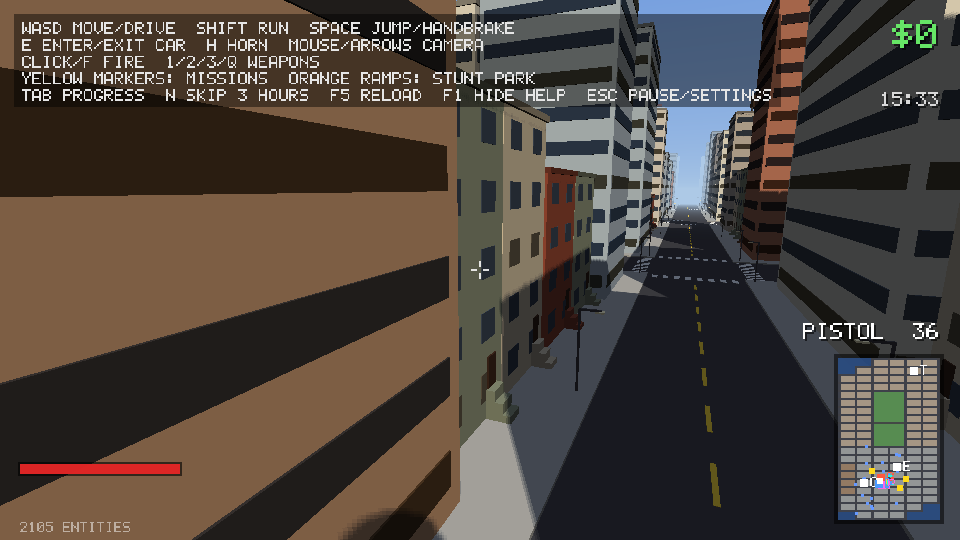 | 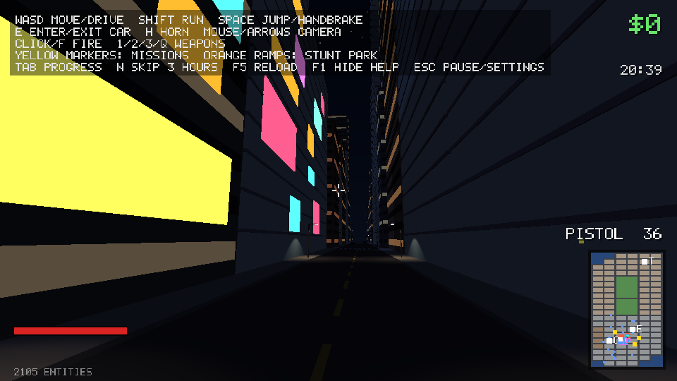 |
| 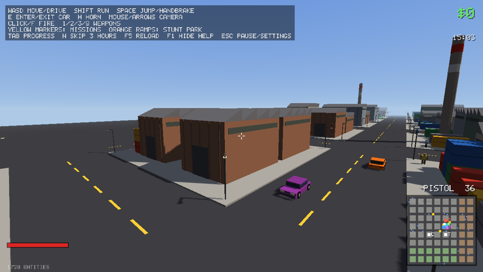 | 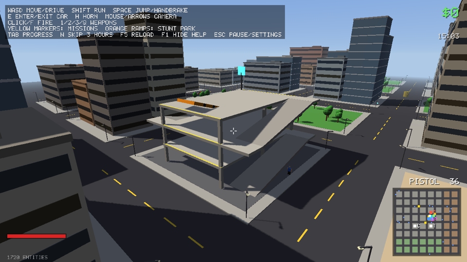 |

`lib/city.lua` lays the city out like Manhattan, all of it boxes:

- **The grid:** 7 avenues run north-south, 16 m wide and 100 m apart, and 21 streets run east-west,
  12 m wide and 48 m apart, so blocks are long 84 × 36 m strips. Buildings are flush with the
  sidewalk on both long sides, a continuous street wall, and avenue corners build taller than
  mid-block. Dashes and zebra crossings are baked into one mesh per grid line.
- **The island:** it narrows at both tips; blocks off it are river, with invisible walls at the
  shore.
- **Central Park:** 2 × 7 blocks with the reservoir and its running track, the lake and its
  fountain, the meadow, a loop drive and about 180 trees. Its inner streets are gone except one
  transverse road across the middle.
- **The skyline** has two peaks, Midtown just south of the park and the Financial District at the
  southern tip, with supertalls up to 50 floors: glass curtain walls with masts, brick with
  window bands, and Art Deco "wedding cake" towers that step back to a crown and spire (each tier
  is its own collider).
- **Uptown** is brownstone terraces (stoops, cornices, a color per house) mid-block and apartment
  houses on the avenues. NYC's wooden water tanks stand on many of the brick roofs.
- **The West Side yards:** warehouses with sawtooth roofs, shipping containers and smokestacks.
- **Small parks:** Washington Square with its arch and fountain, Union Square, Battery Park, and
  glowing billboards over every frontage of Times Square.

Each block draws from its own seeded generator, so the city never touches `math.random` and
changing one block can't reshuffle the rest.

### Maps

The layout is data. `game/maps/manhattan.lua` holds the grid (block and road sizes), the outline
of the land, the park, district rules, the skyline's peaks, the special blocks (lot, plaza,
landmarks, small parks), and **named places**: the hospital, the taxi rank, each mission's
intersections, the race route. `lib/city.lua` builds whatever map it's given and checks it as it
loads, so a place on an intersection without a road, or a landmark in the river, is an error
naming the place. `MAP=harbor auto game` plays the other map, Harbor Town: a smaller, squarer
port with a bay, docks along it, one modest downtown and no big park.

Nothing outside the map file uses grid positions. Missions, the gun shop, pickups, the hospital
and the taxi mod ask for places by name (`city.place("bank")`, `city.route("race")`), and a
mission whose places a map doesn't have sits that map out. CI plays the scripted run and the
city test on every map.

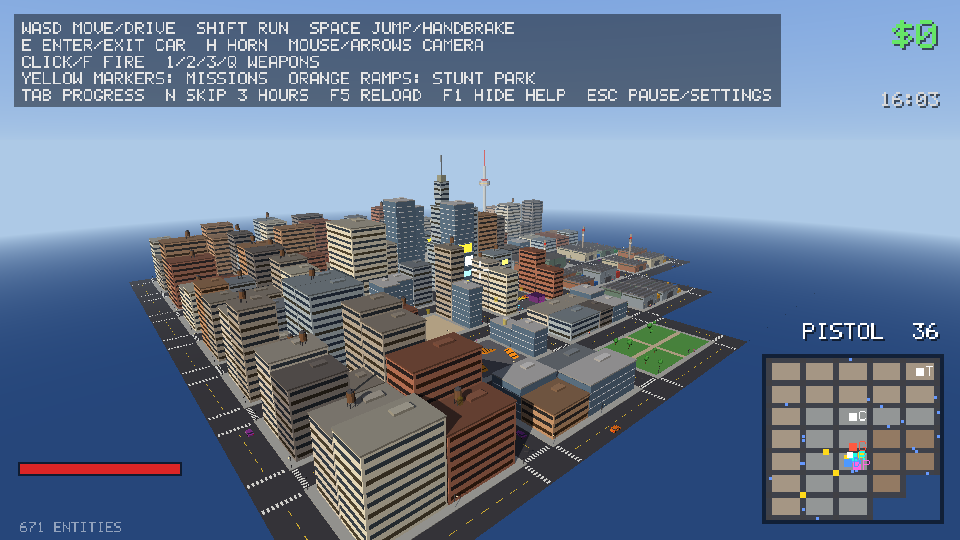

### Maps drawn as roads: Raisio

A map can list its roads instead of a grid. Raisio, Finland, is one, at real size and from real
map data: the center, Mylly, and Nesteentie all the way down to the harbor, north to Raision
sairaala, ABC and Haunisten allas, east past IKEA into Turku, and south to the naval harbor at the
tip of Pansionnokka, about 8 by 8 km. Its 2,900 junctions, 13,500 buildings, the bay, the river,
forest and fields come from
[OpenStreetMap](https://www.openstreetmap.org/). Pick it in the pause menu (Esc, then CITY), or
run `MAP=raisio auto game`. The game remembers the city you picked, and a city picked in the menu
wins over `MAP` when the game restarts there.

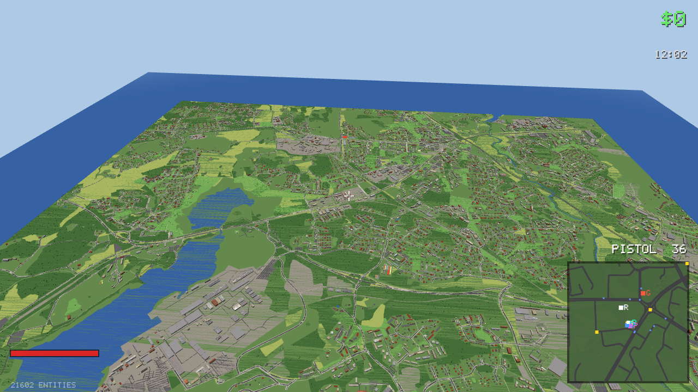

`tools/osm_import.py raisio` turns the map data into `game/maps/raisio_osm.lua`. `--fetch`
downloads it fresh first, a tile at a time (a tile that times out is fetched as four smaller
ones, and a fetch that stops part way carries on where it left off). An area can name an
`origin`, the game's 0, 0, so it can grow in any direction without moving anything a
hand-written map has placed; the map's `center` says where its middle is then. That holds junctions, named after the streets that meet there, and
each road as the junctions and bends it passes through:

```lua
junctions = {["Nesteentie / Raisiontie"] = {1049.1, -1685.9}, ...},
roads = {
  {name = "Nesteentie", kind = "main", width = 10, "Nesteentie / Raisiontie", "Nesteentie / Raisiontie 3"},
},
```

and building footprints as boxes, plus ground cover (water, forest, fields, parks, industry,
parking) as strips. `game/maps/raisio.lua` loads it and adds the game: where you start, the
hospital, the car park at Mylly, each mission's intersections, by street name.

Roads only meet at junctions; one that crosses another anywhere else is an error naming both,
and so is a hand-placed building standing on a road. `lib/roadnet.lua` builds the rest: asphalt,
pavements, center lines and street lamps along every curve, the surveyed buildings (detached
houses with pitched roofs, apartment blocks, shops, warehouses), forest in the woods, the game's
features on 40 m pads, and landmarks placed by hand. A map drawn by hand instead gets buildings
lining its roads by district. The bay and the river stop you like a wall, except on bridges.
Traffic and police follow the bends, pedestrians walk the pavements from junction to junction,
and on a town this big the minimap is a radar that follows you. Every test runs on it.

Raisio isn't flat: it runs from the sea at Raisionlahti up to rocky ridges over 50 m high. Its
ground comes from the National Land Survey of Finland's 10 m elevation model (Maanmittauslaitos,
CC BY 4.0): `tools/osm_import.py` samples it every 10 m (fetching the sheets with a free open data
key in `~/.config/3d-auto/mml-key`; see `tools/dem.py`) and grades the roads into it. Each
road's height is the ground along it smoothed over 40 m (80 m for main roads and highways) and
bent to meet its junctions, and the ground under it is made level across it, out past its
pavements, blending back over 20 m. The result, `game/maps/raisio_terrain.bin`, is heights and a
ground cover class per point; the game hands it to `engine.terrain`, colored by class, so
fields, woods and car parks are painted on the hills. Each road's heights also go in the map
(every 10 m or so), and the game lays them over the ground as the surface you drive on, so roads
are smooth instead of following the 10 m grid's creases.

While the map builds, everything placed on the ground goes onto it: roads in tilted pieces of
at most 6 m (mesh parts take `pitch` now), buildings on the lowest corner of their footprint,
trees, lamps, pitches and the game's pads at the ground under them, water flat at its own level
(the sea at 0, the reservoir higher). Bridges, from the map data's bridge tags, are solid decks
running straight from one end to the other over whatever is below, with railings and piers
where they don't stand on another road; drive under one and you're on the ground below. Cars,
pedestrians, police, pickups and shops spawn at the ground's height (`util.ground(x, z)`, 0 on
the flat maps).

Railway track on the ground comes from the map data's `railway` ways (bridges and tunnels left
out): a ballast bed and two rails 1524 mm apart, a contact-wire mast every 60 m beside an
electrified main line, platforms as raised concrete. Where a track crosses a road, the road is
left as it is. `tools/osm_import.py <area> --only-railways` puts them into an already generated
map without touching the rest of it.

Each road side is built the way Finnish streets are, piece by piece (`classify` in
`lib/roadnet.lua`):

- **Pavement.** Main streets get a raised pavement with a granite kerbstone. Smaller streets get
  one only where the map data's `sidewalk` tag says so, or where a path tagged as a street's
  pavement runs alongside. The importer passes the tag on (`sidewalk = "no"`, `"left"`,
  `"right"`).
- **Grass verge.** Where a separate foot and cycle path (kevyen liikenteen väylä) runs alongside
  instead, the road gets a kerbstone and grass, and the path is drawn where it really is.
- **Median.** Between the two halves of a divided road like Raisiontie or Nesteentie, there's a
  raised median: red paving where it's narrow, grass where it's wide.

Pavements and medians stop where a side street crosses them. Paths are asphalt, or paving stones
where the map data says so, and are left out where they'd run under a road (the game's roads are
a little wider than the real ones). Lamps stand on the pavement, in the verge or on the median.

The kerb is real, not just drawn. Each piece of driving surface the game hands the engine says
how wide its asphalt is and which sides are raised. The engine lifts a raised side by the
terrain's `kerb` (12 cm), except where it lies on any road's asphalt, so a pavement never makes
a step in a crossing. Cars bump up onto pavements, and people stand on them.

**Raisio 2030** (`MAP=raisio2030`, archived under `game/maps/archive/`) is the town as
it will be once the E18 works under the centre are done (Väylävirasto's "E18 Raision keskustan
kohta", built 2026-2029). The E18, Nesteentie, drops into a concrete tunnel of about 450 m
from the new Elauksenkatu up past Raisiontie, with a park on its roof where the Raisio
crossing's traffic lights were. Raisiontie and Elauksenkatu cross over on top, and the old slip
roads are gone, along with Soliniuksenkuja's and Martinkatu's junctions onto the E18. It's
today's map with `lib/tunnel.lua` applied. `tunnel.dig(map, {road =, from =, to =, depth =,
half =, ramp =, cut =})` sinks the named road along an axis and splits its junctions there from
the streets that met it at grade. Those streets now cross over it as decks at their own
surveyed heights, and stubs that only led onto it are cut back. The builder then roofs the
covered stretch with a park and lights its underside, and walls the open ramps. On a map with
levels like this, junction lookups take a height (`city.nearest(x, z, y)`,
`roadnet.nearest_edge(x, z, walkable, y)`). That way police, traffic and pedestrians in the
street don't head for the tunnel under it, and cars spawn on a road's own level, a bridge's or
a tunnel's, not just on the ground. The interchange's ramps and roundabouts west of the tunnel,
Soliniuksenkatu, and the later three-level interchange with valtatie 8 aren't built yet.

**Raisio 1980** (`MAP=raisio1980`, archived under `game/maps/archive/`) goes the other way: the centre the
1970s built on two levels, with cars on the ground and people up on the concrete:
- **The market square** north of Raisiontie, where Torikuja is now, with its stalls and grill
  kiosk.
- **A raised deck** on round columns round three sides of the square, in front of the shops.
- **Concrete footbridges with solid parapets:** two over Raisiontie to Tasala, a ramp down into
  the square, and Keonsilta (1978) east over Kerttulantie and Nesteentie. Only Keonsilta's
  stretch over Nesteentie still stands.
- **What it leaves out:** the 2000s took the rest down and strung the lanterns over Raisiontie,
  and the flats and the glass cube came later. None of that is on this map.

The map adds three features any map can use:
- `decks`: `{x0, z0, x1, z1, open = "nswe"}`, a slab on columns at a footbridge's height, with
  parapets that leave gaps where bridges land or decks join.
- `squares`: paving.
- `market`: stalls.

A footbridge's end can stay `up` to meet a deck, and `concrete` gives it solid parapets. The
sources are Raisio's local history pictures in digi.kirjastot.fi, the town's plan documents and
Finnish Wikipedia. The rest of town is today's.

You always know where you are: the street you're on and the part of town (Raision keskusta,
Kerttula, Mylly, Nuorikkala...) come up in the corner whenever either changes, and when the cops
are called the dispatcher names them too ("All units, suspect seen on Nesteentie, Kerttula"). The
parts of town are OpenStreetMap's suburbs and neighbourhoods, which the importer writes as
`areas`, plus a few added by hand; `roadnet.where(x, z)` gives the street and area for any spot.

The map data says where a building is, not what it looks like, so the places locals know get a
hand-picked `looks` entry in `maps/raisio.lua` (a wall color, brick or glass, floors, or an air
dome): the library, Ulpukka, Raseko, Tiedonpuiston koulu, Raision lukio, and the white dome of
the LähiTapiola Areena next to them. Round buildings in the map data become drums (silos, the harbor's
oil tanks), so Raisio's factory stands up as its silo block and smaller silos, with a hand-placed
brick chimney (a `chimney` in `towers`). `string_lights` hangs the lanterns across Raisiontie
through the center.

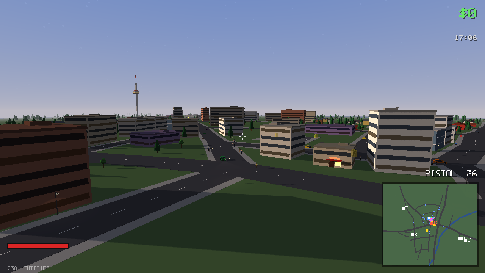

### Make your own city

`game/maps/starter.lua` is the smallest map that runs the whole game (every mission, the shops,
traffic, police), with each field explained. It's MIT licensed, so start from it:

1. Copy it to `game/maps/<yourtown>.lua` and change `name`.
2. Play it with `MAP=<yourtown> auto game`. A place on an intersection without a road, or a
   landmark in the water, stops the game with an error naming it.
3. Reshape it: the grid size, where the land ends, districts, the skyline, and the named places
   missions use. Leave a place out and the missions that need it simply aren't offered.
4. Check it like CI does: `MAP=<yourtown> CITY_TEST=1 auto game --headless 2400` and
   `MAP=<yourtown> MISSION_TEST=1 auto game --headless 6000`, or all of it with
   `python tools/headless_tests.py --output results --maps <yourtown> --seeds 1337`.

To ship your city as its own game, copy the `game/` folder (say to `raisio/`), change the default
map in its `main.lua` (`city.use(os.getenv("MAP") or city.chosen() or "manhattan")`), and run
`auto raisio`. The
engine runs whatever game folder it's given. Give it your own name too (see [License](#license)).

The street network has gaps (the river, the park), so `lib.city` exposes it as a road graph of
junctions and the roads between them: `city.junctions()`, `city.roads()` (each as `{a, b}`),
`city.pos(id)`, `city.links(id)`, `city.nearest(x, z)`, `city.random_near(x, z, min, max)` and
`city.step_toward(from, to)` (the first junction on a shortest route). Traffic, police and the
minimap use only the graph, never grid positions, so they'll follow whatever road layout a map
draws. Grid maps build the graph from their intersections; `city.node(k, l)`, `city.road`,
`city.neighbors`, `city.segments` and `city.block_of` are the grid underneath, which the city
builder and pedestrians (who walk round blocks) still use. The city is about 600 × 970 m, so
traffic follows the player: cars that end up more than 330 m away are moved to a street nearer,
out of sight, and pedestrians spawn on the blocks around you.

Traffic is mostly ordinary cars, with vans, taxis (a lit TAKSI sign) and the odd sports car
among them (`prefabs.CAR_KINDS`, `vehicle.KINDS`). Each kind has its own collider and pull: from
a standing start, 3 s at full throttle reach about 32 m/s in a sports car, 25 in a car and 19
in a van. The lot always has a sports car and a van at its far end, and a respray keeps the
kind of car (`vehicle.spawn(x, z, yaw, colour, "van")`). `CARKINDS_TEST=1` checks them.

`lib/landmarks.lua` adds three one-off places (`E`, `T` and `C` on the minimap):

- **The Empire,** an Art Deco tower in Midtown and the tallest thing in town: 186 m to the top
  tier, then a lit crown and a mast with a red light on top.
- **The TV tower,** 100 m tall uptown, floodlit at night with a red beacon on top.
- **The car park,** three decks with stacked ramps up the east and west sides, entered from the
  south street. The roof has a kicker on its south edge.

A bigger city meant more static boxes, and the physics compared every moving body against every
box. It now keeps static bodies in a grid that is only rebuilt when one moves, and still visits
pairs in the same order, so every test's simulation is bit-for-bit identical. A soak tick is about
1.1 ms. The Manhattan island (three times the area, a few more cars) costs about a quarter more
per tick than the old 8 × 8 grid did.

Raycasts walk the same grid now, cell by cell along the ray, and stop past the nearest hit; they
also test big statics, whatever was moving at the last step, anything spawned since, and statics
moved since (`set_pos` and friends note them), so they find exactly what testing every entity
would. On Raisio's 30,000 entities a 5-star chase spent 13–15 ms of each 16.7 ms tick on police
line-of-sight rays; it's now about 0.2 ms. `engine.find` reads a per-tag index instead of
scanning.

## Wanted level and police

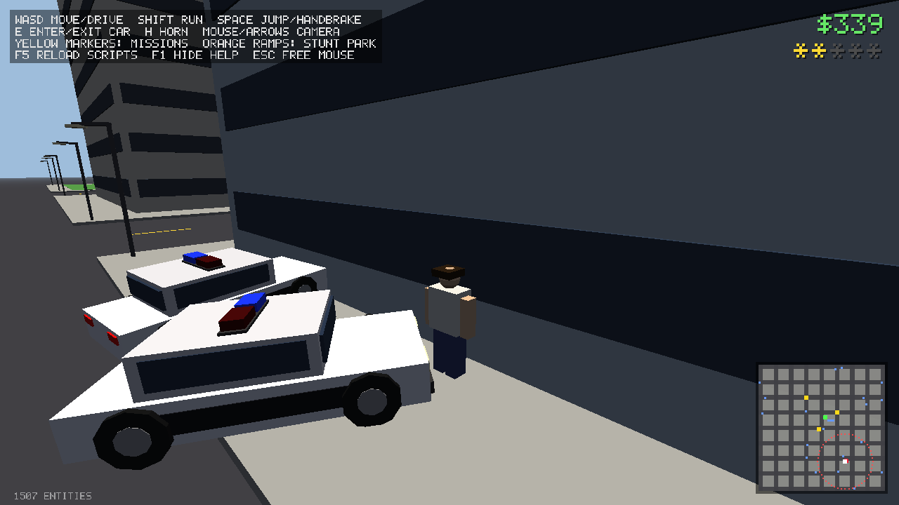

`lib/wanted.lua` and `systems/police.lua` are about 350 lines of Lua and needed **no engine
changes**, which is the point of the kernel:

- **Crimes:** carjacking a traffic car, hard crashes into civilian cars, ramming or stealing a
  cop car. Missions can call `m:wanted(3)`.
- **Police:** 1/2/3/5/7 cop cars for 1–5 stars, spawned out of sight around the search area.
  They follow the street grid toward you (or your last known position), switch to direct pursuit
  once they can see you (a raycast), and search nearby streets once they lose you. Light bars and
  sirens follow each car.
- **Busted:** stop (or stand) next to a cop for 1.5 s. You pay a fine, the wanted level clears,
  any active mission fails, and you're released on foot.
- **Escape:** the red circle on the minimap is the search area around where you were last seen.
  Get out of it and stay unseen: 3 s at one star, 5.5 s more for each star after (25 s at five).
  Hidden inside it, they give up after 30 s (70 s at five). The stars blink while they can't see
  you, and being seen starts the clock over.

## Shops

| | |
|---|---|
| 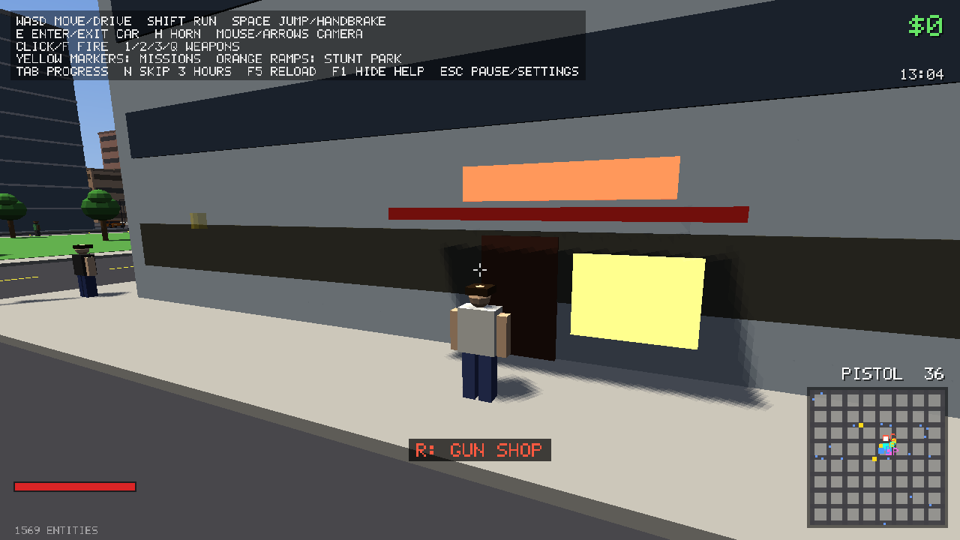 | 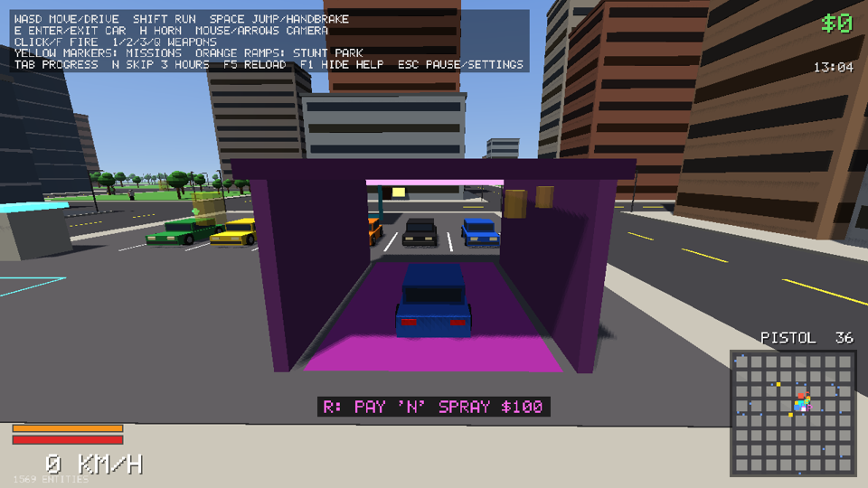 |

Cash from missions and stunts buys things. Each shop is a zone with a prompt and a letter on the
minimap; press **R** there. `lib/shop.lua` is the shared part (zone, prompt, blip, paying), and
the shop counters are pages in the pause menu, so buying pauses the game.

- **Gun shop (G),** across the street north of the lot, on foot: pistol ammo (+24, $60) and the
  SMG (+90 rounds, $250).
- **Pay 'n' Spray (P),** in the lot. Drive in, stop, and pick a color for $100 plus $100 per star.
  A respray clears your wanted level, but only if the cops can't see you when you go in. No cop
  cars.
- **Car dealer (D),** the booth in the lot: buy a car of your own for $600. It's delivered to the
  blue space next to the booth and shows on the minimap. It's saved with your progress, so it's
  back in its space, in its current color, every time you start the game, even if it was
  wrecked.

Ammo is saved with your progress too. The only engine change is `engine.set_mesh`, which a
respray uses to swap the car's model.

## Repair garage

The cyan repair bay in the starting parking lot gives mission and stunt cash a use.
Drive under its canopy, stop upright, and press **R** to pay **$100** for a full repair.
The cyan `R` on the minimap marks its location, and the bay shows the price or why
service is unavailable. Repairs restore vehicle health and stop smoke/fire, including
cancelling a burning car's pending explosion. Already healthy cars aren't charged;
wanted drivers must lose the cops first. Repairs don't restore player health or wrecks.

## Pause menu and settings

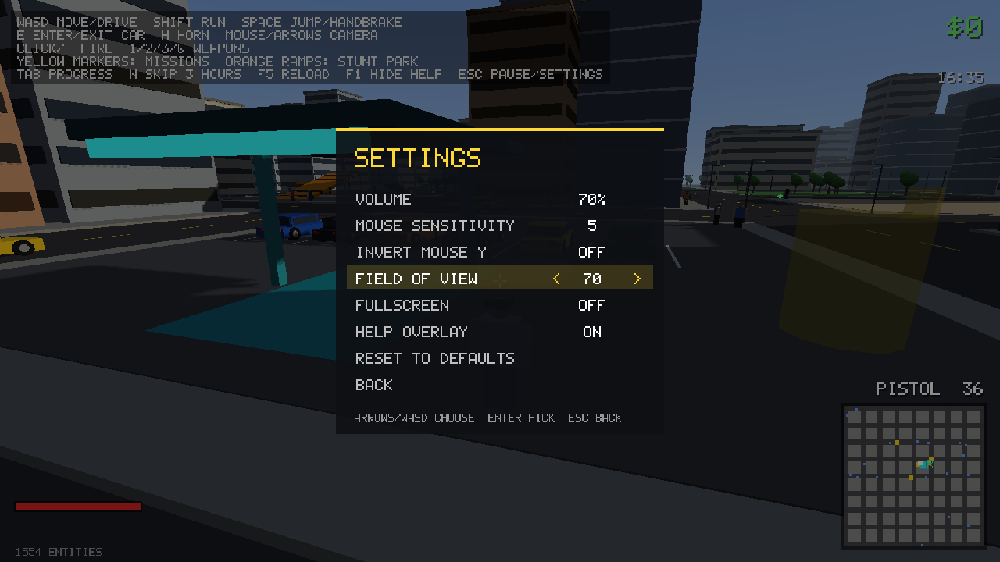

`Esc` pauses (so does minimizing the window). `lib/menu.lua` and `lib/settings.lua` are about
230 lines of Lua on four small engine additions: `engine.pause`, `engine.cursor`,
`engine.fullscreen` and `ui` sounds.

- **Pausing really stops the game.** The engine skips ticks, so physics, the clock, mission
  timers and police all wait, and game sounds freeze where they are. `frame` keeps coming,
  with `dt = 0`, so the HUD and menu still draw and per-frame effects hold still.
- **Input goes to the menu.** While paused, key events arrive as `menu_key`, not `key`, so
  pressing `E` in the menu doesn't get you out of a car. Keys held when you pause are released
  to the game first, so a held trigger or accelerator doesn't stick.
- **Settings:** volume, mouse sensitivity, invert mouse Y, field of view, fullscreen, the
  help overlay (`F1` changes it too), and for slower GPUs shadows and view distance (a share of
  the map's fog distance; nothing past it is drawn). They're saved in the `settings` save as you change them
  and applied on the next start. The menu works with arrows/WASD + Enter, or the mouse.
- **Quit Game** in the menu saves progress like closing the window does.

## Saves

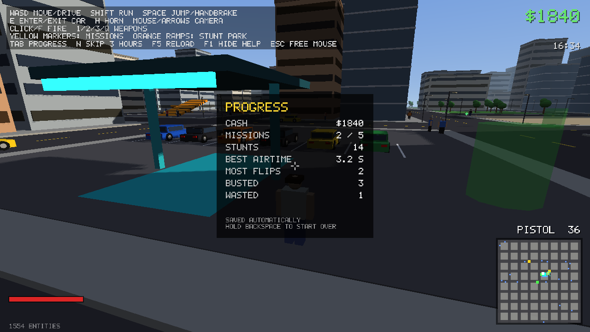

`lib/progress.lua` (~130 lines) keeps cash, the missions you've passed (their markers stay
green), and stunt, busted and wasted records. It saves two seconds after anything changes
and again when the game closes, so a hot reload (F5) no longer resets your cash either.
`Tab` shows the record; holding `Backspace` on that screen starts a new game.

The engine side is `engine.save(key, value)` and `engine.load(key)`:

- **Where:** each key is one file, `<key>.lua`, in `~/.local/share/auto/<game>` on Linux,
  `%APPDATA%\auto\<game>` on Windows and `~/Library/Application Support/auto/<game>` on macOS.
  The game prints the folder at startup. `--save-dir DIR` puts saves somewhere else.
- **Format:** readable Lua table syntax, so you can open and edit it. It's parsed as data and
  never run, so a save can't execute code. Writes go to a temp file that's renamed into place,
  so a crash mid-save keeps the old file.
- **Bad files:** if a save can't be parsed, `load` returns `nil` plus the error and moves the
  file to `<key>.lua.bad`, so a hand-edit gone wrong isn't overwritten. The game then starts
  fresh and says so.
- **Limits:** 64 keys and 256 KB per value; functions, cycles, infinity and NaN are refused.
- **Tests never touch your progress:** `--headless`, `--screenshot` and `--frames` runs keep
  saves in memory unless you pass `--save-dir`. CI runs the game three times on one folder to
  check that progress survives a restart and that a corrupt save is set aside.

## Combat and health

About 700 lines of Lua across `lib/health.lua`, `lib/fx.lua`, `lib/pickups.lua`,
`systems/weapons.lua` and `systems/carnage.lua`. The engine only gained a per-entity `glow`, so
muzzle flashes and fireballs light up in daylight too.

- **Weapons:** fists, a pistol and an SMG. You aim with the camera and shots trace from the
  player's chest, so walls and cars are real cover. Tracers, muzzle flashes and hit sparks are
  plain entities.
- **Health:** the player, pedestrians, officers and cars all have it. At zero you're
  **WASTED**: you ragdoll, the screen fades, and you wake up at the hospital minus a bill; stars
  clear and the mission fails. Health and ammo pickups glow around town.
- **Cars:** they take damage from bullets and hard crashes into solid things (not ramp landings,
  and not AI fender-benders). Badly damaged cars smoke, then burn, then explode. Explosions throw
  bodies, kill people nearby, chain to other cars and leave a wreck.
- **Police:** at 2+ stars, cops that catch you get out and shoot, with accuracy that falls off
  with distance and your speed, and cover blocks their line of sight. Driving away makes them get
  back in. Killing one adds a star. At 1 star they still only try to arrest you.
- **Crimes:** gunfire with witnesses gets you a star, and killing someone adds one.

| | |
|---|---|
| 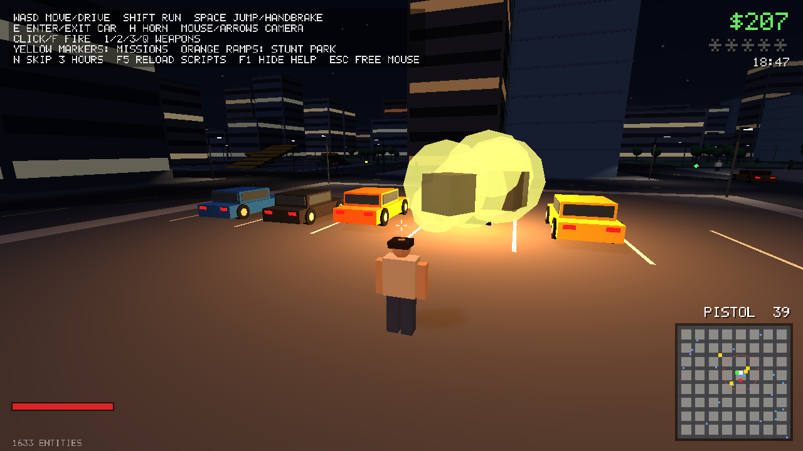 | 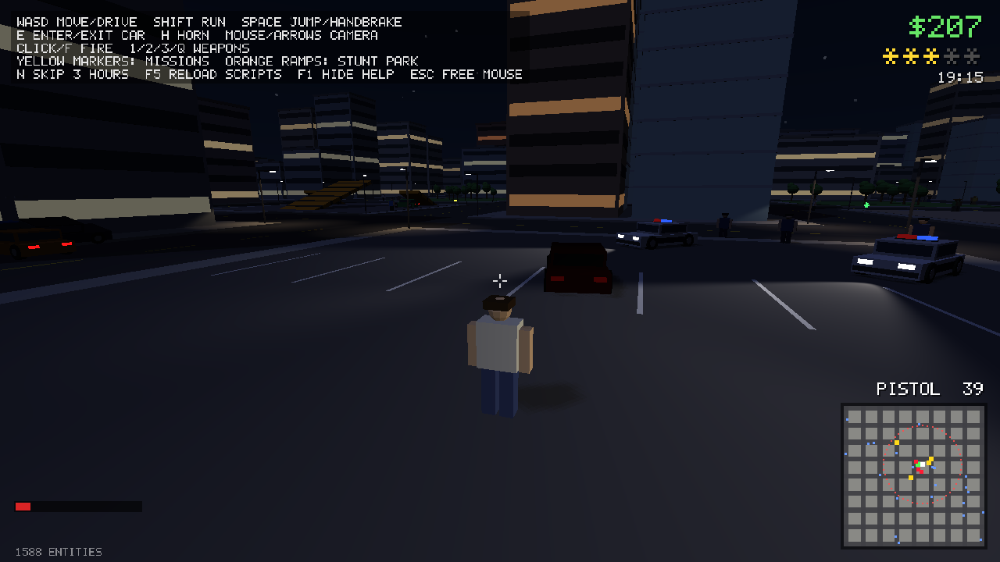 |

## Pedestrians

`systems/peds.lua` (~270 lines, again no engine changes) keeps about 40 people near the player:

- **Walking:** they circle their block's sidewalk and sometimes cross at a corner, waiting at
  the curb while a car is coming. Traffic brakes for them.
- **Fleeing:** a fast car heading at them, the horn (`H`), or a nearby crash makes them run
  away screaming.
- **Hit by a car:** the upright walker (`lock_rotation`) is swapped for a free rigid body, so
  they tumble. If you were driving, it's a crime: `ped_down` raises your wanted level.
- **Population:** people far from the player are recycled 70–140 m away, out of view.

Adding them pushed physics past a millisecond per tick, so this PR also has the only engine
changes: a bounding-sphere reject in raycasts (raycasts were ~24% of the profile), building
rotation matrices directly from the quaternion, and skipping angular work for bodies that
can't rotate. A tick is back under 1 ms with 40 pedestrians, 18 cars and the police.

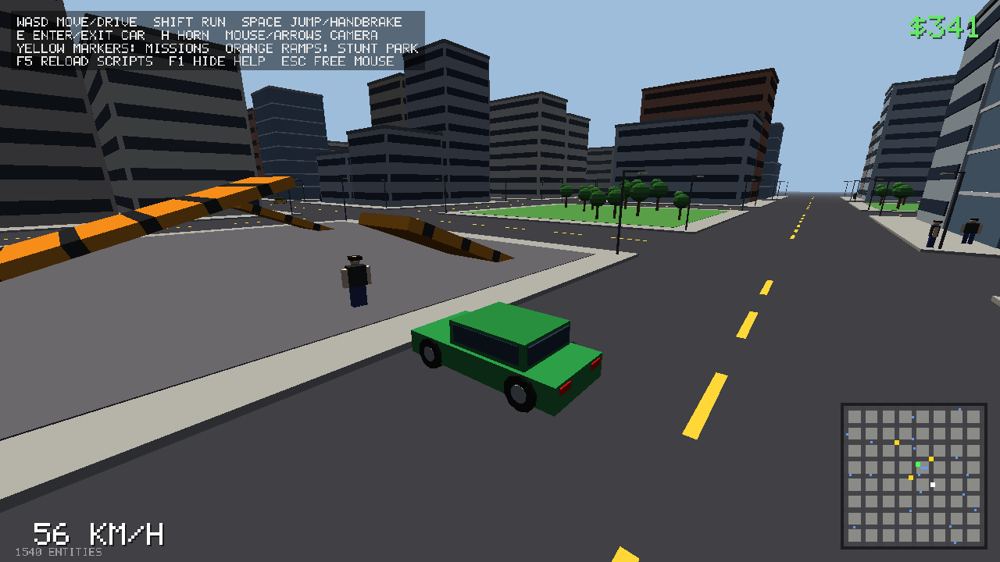

## Mods

Drop a folder into `game/mods/` and it loads automatically, sandboxed (no `os`, `io` or
`debug`, and no file access outside its own folder). Two example mods ship with the game:
a taxi side job and a debug overlay (F3). See **[MODDING.md](MODDING.md)**.

## Adding a mission

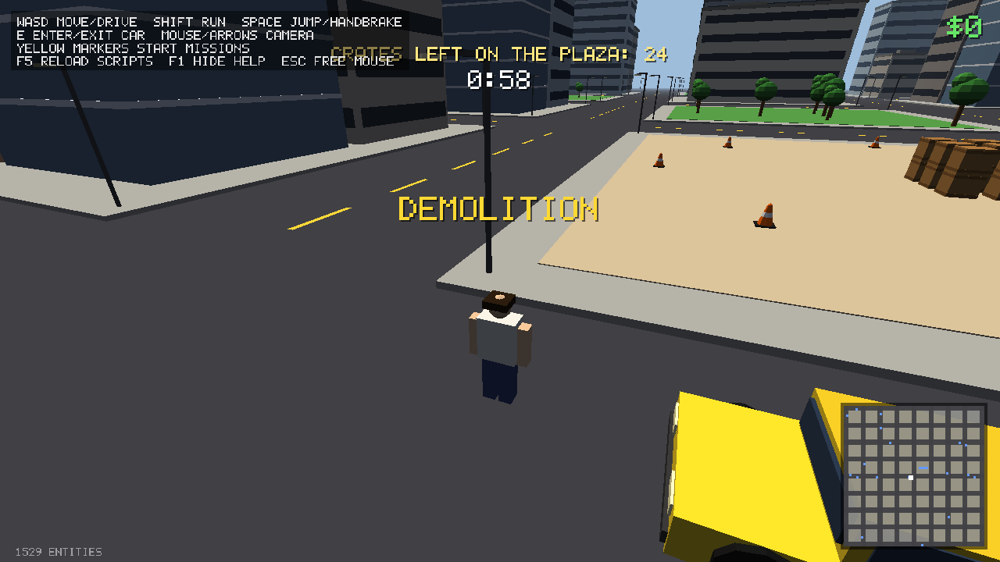


Drop a file in `game/missions/`. It's picked up on the next reload. Find places by name, not
grid position, so the mission works on any map (`lot` and `hospital` are on every map):

```lua
local city = require "lib.city"
return {
  title = "Pizza Run", start = {city.place("lot")}, reward = 100,
  run = function(m)
    m:say("Get a car")
    m:wait(function() return m:in_car() end)
    -- Some street corner 150-250 m away, on whatever map is loaded.
    local x, z = city.place("lot")
    local door = m:marker(city.pos(city.random_near(x, z, 150, 250)))
    m:timer(45)
    m:wait(function() return m:near(door, 5) end)
  end,
}
```

A mission that needs a place only some maps have checks first and returns `false` to sit this
map out: `if not city.has("bank") then return false end`.

Set `after = "<file name>"` to keep a mission locked until another is passed: Fragile Cargo,
Takedown and Smuggler's Run open one by one after Getaway, and passing one announces the next.

## Command line

```
auto [GAME_DIR] [--headless TICKS] [--screenshot OUT.ppm] [--frames N] [--ticks-per-frame K] [--size WxH] [--save-dir DIR] [--fps N] [--fullscreen]
```

Interactive play is capped at **60 FPS** by default, including while paused. `--fps N`
sets a different render-rate limit; `--fps 0` disables it. Physics still runs at a fixed
60 Hz. Headless, screenshot and `--frames` runs are not slowed by the render-rate cap.
`--fullscreen` starts this session fullscreen even if the saved setting is windowed;
launching does not rewrite the saved setting, and the pause menu can still turn it off.

`AUTO_TEST=1 auto game --headless 9000` plays the demo by itself (drives, finishes a mission,
launches off the stunt ramp, gets busted by the police, then escapes them). `SEED=<integer>`
controls population and AI randomness on either map; the default is 1337. For example,
`MAP=harbor SEED=5 AUTO_TEST=1 auto game --headless 9000` reproduces that case.
Lua errors exit non-zero, and so does a test that runs out of ticks before it finishes.
Acceptance still requires both `AUTOPLAY PASSED` and `GARAGE PASSED`, no Lua/FAILED
messages, and exit zero. The maintained runner checks all three and preserves raw logs:

```
python tools/headless_tests.py --output headless-results --soak
```

Use a new output directory each time. Both autoplay AND focused reliability consume the same
explicit map/seed pairs: Manhattan, Harbor and Raisio each use `0, 1–12, 13, 17, 42, 99, 1337, 2026`.
The runner deduplicates inputs, verifies each printed map/seed identity, and reconciles the exact
pair set. Seed runs use three concurrent native processes by default (`--jobs 1` serializes).
Focused checks cover police/attribution/corridor/chain-explosion regressions; the full suite also
runs city and pad checks, isolated save/menu/shop restarts (including exact corrupt-save bytes),
and, with `--soak`, five simulated minutes per map.
`MAP=harbor SEED=17 RELIABILITY_TEST=1 auto game --headless 4000` runs one focused pair.
CI reuses one build per platform: Linux and Windows run the full maintained seed set on both
suites; macOS explicitly checks both suites on every map at 1337. Only Linux runs the soak. Raw logs and
a reconciled results matrix are uploaded as CI artifacts even when a check fails.

`MESH_REPORT=1` with `--headless` lists where the mesh memory goes, by mesh name. For example,
`MAP=raisio MESH_REPORT=1 auto game --headless 2` shows terrain at 93 MB, roads at 38 and paved
areas at 26.

`PROFILE=1` prints where the frames' time goes every two seconds: frames per second, ticks per
frame (Lua and physics), the Lua `frame` event, drawing (CPU side, with draw calls and
triangles), and the rest of the frame, waiting for the GPU and the display. If the wait is large
and everything else is small, the GPU is the limit. Under each line: the worst single frame of
those two seconds, split the same way, with how many frames took over 50 ms, and the three Lua
handlers slowest in one call (event and file:line). With `--headless` each tick counts as a frame.
`PROFILE_DRIVE=1` puts a robot at the wheel of the player's car, across the map at city speed with
two stars after a minute, so `PROFILE=1 PROFILE_DRIVE=1 MAP=turku auto game --headless 12000`
profiles a three-minute drive with nobody playing.

`SHOT_CAM="x,y,z,tx,ty,tz[,fov]"` pins the camera for screenshots (`FOG="near,far"`
pushes the fog back for wide shots). `SOAK=1` runs a traffic soak
test, `SAVE_TEST=1`, `2` and `3` with a shared `--save-dir` test saves across restarts, and
`MENU_TEST=1` and `2` the pause menu and settings, `SHOP_TEST=1` and `2` the shops, `CITY_TEST=1` the loaded map's layout (a connected road graph with nothing built on it, the
shore walls, the skyline's peaks, the landmarks) and a drive up the car park, `MAP=harbor` any of
these on the second map, `PAD_TEST=1` the gamepad controls, and `MISSION_TEST=1` the later
missions and the order they unlock in (see `.github/workflows/ci.yml`). Headless runs mix audio into a discarded buffer, so the mixer is exercised too. CI runs
all of this on Linux, Windows and macOS.

## Cover art

<p>
  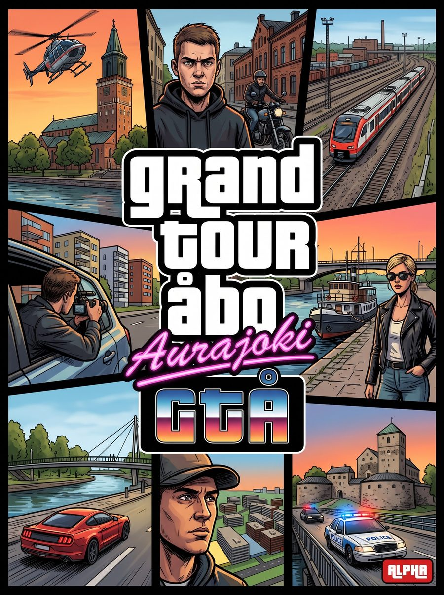
  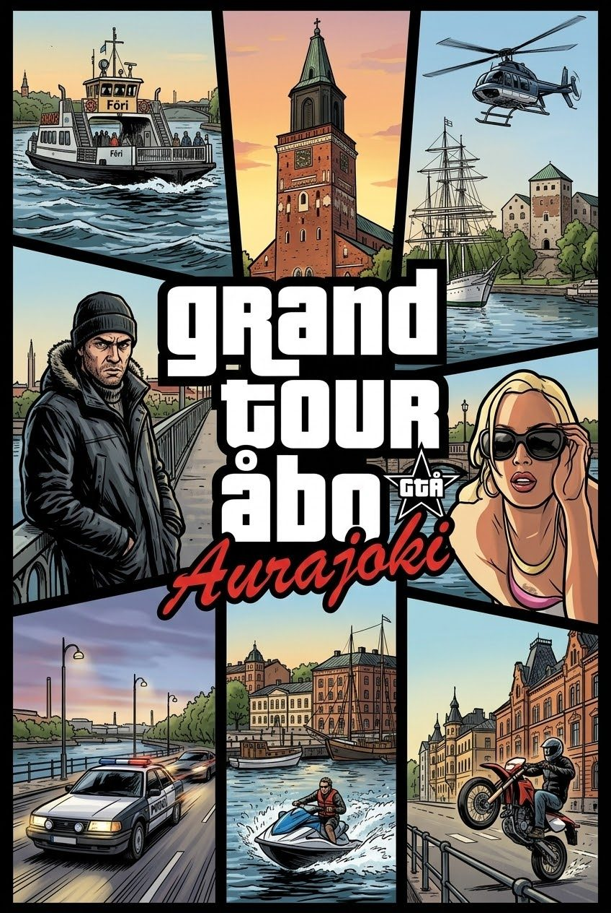
</p>

The covers are AI-made from Oliver Mikkola's prompts, in tribute to the Grand Theft Auto box art.
They are fan art: not made by, endorsed by or connected to Rockstar Games. The MoE logo belongs to
[MoE Systems](https://moesystems.com).

## Releasing

Push a tag (`git tag v0.1.0 && git push origin v0.1.0`). The release workflow builds and smoke
tests each platform, then publishes `auto-v0.1.0-{linux-x86_64,windows-x86_64,macos-arm64}`
archives with the binary, `game/`, and the docs.

## License

The engine and the game's code are free to use, change and sell. The three cities can be shared
and remixed, but not sold.

- **MIT** ([LICENSE](LICENSE)): everything except the city maps. That's the engine (`src/`),
  the game systems and missions (`game/lib`, `game/systems`, `game/missions`), the mods, tools,
  tests and docs, and `game/maps/starter.lua`.
- **CC BY-NC 4.0** ([game/maps/LICENSE](game/maps/LICENSE)): `game/maps/manhattan.lua`,
  `game/maps/harbor.lua` and `game/maps/raisio.lua`. Share and adapt them with credit, but not commercially. Versions up to
  and including v0.2.0 were released entirely under MIT, and those copies stay MIT.
- **ODbL 1.0**: `game/maps/raisio_osm.lua`, generated from OpenStreetMap data,
  © OpenStreetMap contributors (see [game/maps/LICENSE](game/maps/LICENSE)).
- **CC BY 4.0**: `game/maps/raisio_terrain.bin`, Raisio's ground heights: contains data from the
  National Land Survey of Finland (Maanmittauslaitos) elevation model, 2026.

**The name.** Neither license covers the name "3D-auto". Fork it, build your own town on it, and
release that, but under a name of your own, so nobody mistakes your game for this one (or this one
for yours). "Built with the 3D-auto engine" is fine.
