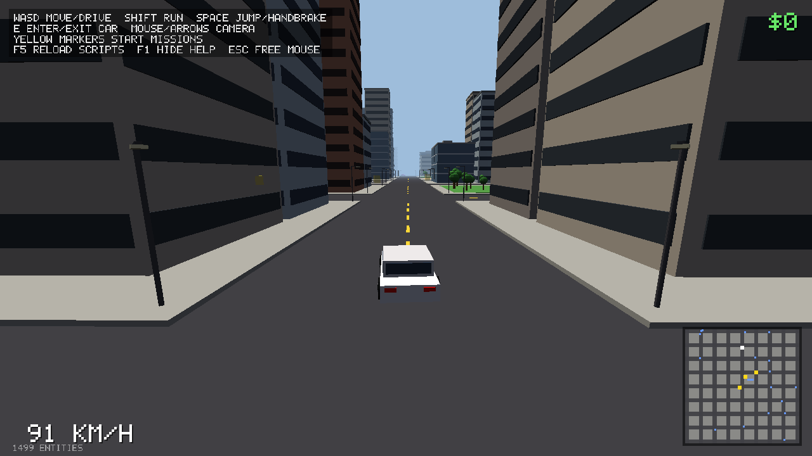

# auto

A minimal 3D sandbox kernel in Rust. One ~1 MB binary renders low-poly meshes, runs
rigid-body physics, mixes sound, and forwards input. **The game is entirely Lua**: the binary emits events
into a tiny pub/sub bus, and scripts build the world on top of it.

The bundled `game/` directory is an open-city demo in about 1,000 lines of Lua. It has a
procedural city, drivable cars that can jump and roll, a stunt park, on-foot movement,
ambient traffic, synthesized sound, a minimap, cash, and three missions. Edit any `.lua` file while it runs and it hot-reloads.



```
cargo run --release              # runs ./game
cargo run --release -- my_game   # any directory with a main.lua
```

Controls: `WASD` move/drive · `Shift` run · `Space` jump/handbrake · `E` enter/exit car · `H` horn ·
mouse or arrow keys for the camera · `F5` reload · `F1` help · `Esc` free the mouse.

## Design

| Piece | Lines | Notes |
|---|---|---|
| `src/math.rs` | ~250 | `Vec3`, `Quat`, column-major `Mat4`. Y up, right-handed. |
| `src/mesh.rs` | ~250 | Flat-shaded unit primitives, OBJ+MTL loader, part baking. |
| `src/physics.rs` | ~580 | Oriented boxes: SAT, corner contacts, warm-started sequential impulses. |
| `src/audio.rs` | ~510 | Mixer with pitch and 3D panning, synth, WAV loader, output backends. |
| `src/render.rs` | ~290 | miniquad/GL: lit + fogged opaque pass, sorted alpha pass, HUD quads. |
| `src/script.rs` | ~450 | The `engine` Lua table and the event bus. |
| `src/main.rs` | ~380 | Fixed 60 Hz tick, input, hot reload, headless + screenshot modes. |

Choices made to keep it small:

- **No ECS and no scene graph.** An entity is a position, yaw, scale, mesh, color, an optional
  body, and a tag. Lua holds plain integer ids.
- **Physics is boxes, but real ones.** Every body is an oriented box with mass and inertia.
  The separating axis test finds the normal, penetrating corners are the contacts, and
  sequential impulses with warm starting (so stacks rest) give linear and angular response.
  Cars roll, crates tumble, and a tilted static box is a ramp. No meshes collide, only boxes.
- **Sound is synthesized.** `engine.synth` renders sfxr-style effects at load, so the demo
  ships no audio files. On Linux, ALSA is `dlopen`ed (no build dependencies); elsewhere
  it's `cpal`. With no device the game runs silently.
- **Prefabs are baked.** `engine.mesh(name, parts)` merges primitives into one mesh, so a car
  costs one draw call.
- **Missions are coroutines.** A mission reads top to bottom: `m:wait(...)`, `m:timer(...)`.
- **Deterministic headless mode.** `--headless N` runs N ticks with no window. CI uses it to
  play the game through scripted input (`game/test/autoplay.lua`).


## The event bus

The engine only ever calls `engine.emit(event, ...)`:

| Event | Args | When |
|---|---|---|
| `init` | | after `main.lua` runs |
| `tick` | `dt` | fixed 60 Hz, before physics |
| `contact` | `a, b, speed` | each touching body pair after physics; `speed` = impact speed in m/s |
| `frame` | `dt` | once per rendered frame; build the HUD and camera here |
| `key` | `name, down` | keys: `a`-`z`, `0`-`9`, `space`, `shift`, `up`, `f1`, `mouse1`, ... |

Scripts subscribe with `engine.on(ev, fn)`, `engine.once`, `engine.off`, and can emit their
own events (the demo uses `vehicle_enter`, `mission_passed`, `stunt`, and so on). A handler that
throws is reported on screen with a traceback, and the other handlers still run.

## Lua API

```lua
-- entities
id = engine.spawn{mesh="cube", pos={x,y,z}, size={w,h,d}, scale=..., yaw=0, pitch=0, roll=0,
                  color={r,g,b,a}, tag="crate", visible=true,
                  body="static"|"dynamic"|"kinematic", mass=1, friction=0.6,
                  restitution=0, gravity=1, sensor=false, step=0, lock_rotation=false}
engine.despawn(id)          engine.exists(id)
engine.pos(id) -> x,y,z     engine.set_pos(id, x,y,z)
engine.yaw(id)              engine.set_yaw(id, radians)   -- heading; keeps pitch and roll
engine.orient(id, yaw[, pitch[, roll]])                   engine.rot(id) / set_rot(id, x,y,z,w)
engine.forward(id) / up(id) / right(id) -> x,y,z          -- local +Z, +Y, -X in world space
engine.vel(id) -> x,y,z     engine.set_vel(id, x,y,z)
engine.angvel(id) -> x,y,z  engine.set_angvel(id, x,y,z)  -- rad/s, world space
engine.push(id, ix,iy,iz[, px,py,pz])                     -- impulse, optionally at a point
engine.grounded(id)         engine.tag(id)                engine.find(tag) -> {ids}
engine.set_color(id, r,g,b[,a])   engine.set_visible(id, bool)   engine.set_scale(id, s)
engine.nearest(x,y,z, radius[, tag[, ignore]]) -> id, dist
engine.raycast(ox,oy,oz, dx,dy,dz[, max[, ignore]]) -> id, dist, hx,hy,hz, nx,ny,nz

-- meshes (builtin unit shapes: cube wedge cylinder sphere plane)
engine.mesh(name, {{mesh="cube", pos=..., size=..., yaw=..., color=..., axis="x"}, ...})
engine.load_obj(name, "assets/thing.obj")      -- usemtl/Kd become vertex colors

-- sound (mono, 44.1 kHz; voices with pos/follow are panned and attenuated from the camera)
engine.synth(name, {wave="square"|"saw"|"sine"|"triangle"|"noise", freq=440, freq_end=,
                    dur=0.3, attack=, release=, volume=0.5, lowpass=1, notes={...}, note_len=, loop=false})
engine.load_wav(name, "assets/boom.wav")                  -- 8/16-bit PCM, any rate
voice = engine.play(name[, {volume=1, pitch=1, loop=false, pos={x,y,z}, follow=id}])
engine.set_voice(voice, {volume=, pitch=, pos=})  engine.stop(voice)  engine.playing(voice)
engine.volume(master)

-- world
engine.camera(ex,ey,ez, tx,ty,tz[, fov_deg])  engine.camera_pos() -> x,y,z
engine.sky(r,g,b)  engine.fog(start, end)  engine.sun(x,y,z)  engine.gravity(g)

-- input & HUD (pixels, origin top-left)
engine.key(name)  engine.mouse() -> dx,dy  engine.grab_mouse(bool)  engine.screen() -> w,h
engine.rect(x,y,w,h, r,g,b[,a])  engine.text(str, x,y[, size[, r,g,b,a]])  engine.text_width(str[, size])

-- misc
engine.time()  engine.ticks()  engine.stats()  engine.files(dir)  engine.quit()
```

## Adding a mission


Drop a file in `game/missions/`. It's picked up on the next reload:

```lua
local city = require "lib.city"
return {
  title = "Pizza Run", start = {city.node(2, 2)}, reward = 100,
  run = function(m)
    m:say("Get a car")
    m:wait(function() return m:in_car() end)
    local door = m:marker(city.node(6, 1))
    m:timer(45)
    m:wait(function() return m:near(door, 5) end)
  end,
}
```

## Command line

```
auto [GAME_DIR] [--headless TICKS] [--screenshot OUT.ppm] [--frames N] [--size WxH]
```

`AUTO_TEST=1 auto game --headless 3000` plays the demo by itself (drives, finishes a mission,
launches off the stunt ramp) and exits non-zero on any failure. `SOAK=1` runs a traffic soak
test. Headless runs mix audio into a discarded buffer, so the mixer is exercised too.
