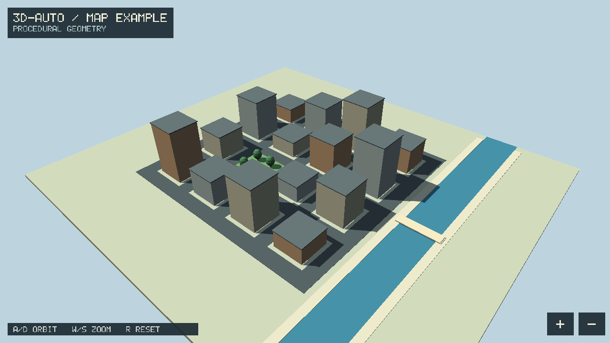

# 3D-auto

[](https://github.com/olivermikkola/3D-auto/actions/workflows/ci.yml)

A small 3D engine in Rust with Lua scripting. It renders meshes, simulates
rigid bodies, mixes sound and forwards keyboard, mouse, touch and gamepad
input. Applications supply their own scripts and assets.

It has two renderers that draw the same scripts:

- **OpenGL**: the default window, and the only one in the browser.
- **wgpu** (Vulkan, Metal, DX12): textured materials, HDR with a filmic tone
  map, ambient occlusion and reflections, cached sun shadows, night street
  lamps, rain, skinned people, and meshes streamed in tiles. It was built for a
  city game on an integrated GPU, and draws a 1 km² city street at 1080p in
  about 9 ms on a Radeon 890M. See [docs/RENDERER.md](docs/RENDERER.md).

The included example is a fictional map: streets, buildings, a park and a
canal. It demonstrates the engine without missions, characters or game assets.



To try the current engine example in a browser, build it locally with
[the WebAssembly instructions](web/README.md). For the historical Turku game,
[play GTÅ](https://moesystems.com/labs/gta/) or browse the
[historical game releases](https://github.com/olivermikkola/3D-auto/releases).

## Run

```sh
cargo run --release
cargo run --release -- path/to/your_scene
cargo run --release -- game --wgpu        # the same in a wgpu window (HDR on; --no-hdr)
```

The default scene lives in `game/` for compatibility with existing launchers.
It is a standalone map example; edit `game/maps/example.lua` to change its
layout. Left/right or A/D orbit, up/down or W/S zoom, and R resets the view.
On touch screens, drag to orbit and use the + / - buttons to zoom.
F5 reloads scripts. Escape exits. The example uses no downloaded map data.

## Build and verify

```sh
cargo fmt --check
cargo clippy --release -- -D warnings
cargo clippy --release --no-default-features -- -D warnings   # OpenGL only, as the browser builds it
cargo test --release
cargo build --release
python3 tools/check_demo.py
```

For a real rendered screenshot on Linux with software GL:

```sh
LIBGL_ALWAYS_SOFTWARE=1 xvfb-run -a target/release/auto game --frames 4 --screenshot map.ppm
```

The wgpu renderer takes offscreen pictures without a window (add `--hdr` for
the tone-mapped look, `WGPU_BENCH=60` for GPU time per stage):

```sh
target/release/auto game --render-size 1600x900 --frames 4 --screenshot map-wgpu.ppm
```

`web/build.sh` builds the same example for WebAssembly. See
[web/README.md](web/README.md). CI verifies the native scene and browser build.

## Build your own scene

Put a `main.lua` in a directory and pass that directory to `auto`. Subscribe to
engine events, spawn meshes and set a camera. [The Lua API](docs/API.md)
describes the bindings. The engine is independent of the bundled example.

```lua
engine.on("init", function()
  engine.spawn{mesh="cube", pos={0, 1, 0}, size={2, 2, 2}, color={0.5, 0.7, 0.8}}
end)
engine.on("frame", function()
  engine.camera(8, 6, 8, 0, 0, 0)
end)
```

The binary supports `--headless TICKS`, `--frames N`, `--screenshot OUT.ppm`,
`--record OUT.rgb`, `--ticks-per-frame N`, `--size WxH`, `--save-dir DIR`,
`--fps N` and `--fullscreen`. The wgpu renderer adds `--wgpu` / `--gl`,
`--render-size WxH`, `--render-scale`, `--upscale`, `--hdr` / `--no-hdr` and
`--material-pack DIR`; `auto --pack-meshes DIR` packs OBJs into fast-loading
`.mesh` files for streaming. Run `auto --help` for syntax.

`--no-default-features` builds the OpenGL-only engine, without wgpu.

## Repository scope

This repository contains the reusable engine, browser runtime and generic
example. Application-specific gameplay, maps, artwork and tests have moved
to a separate repository. Historical branches, tags and releases retain their
original contents and licenses. The split changes current source, not history.

## License

MIT; see [LICENSE](LICENSE). Vendored Lua retains its own notices under
`web/lua-src/`. The example uses procedural geometry and shares the MIT license.
