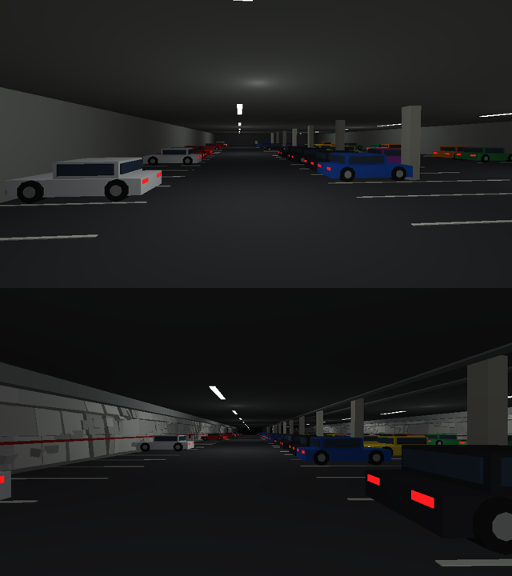
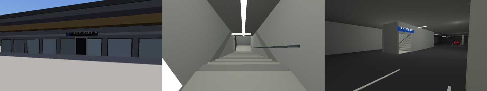
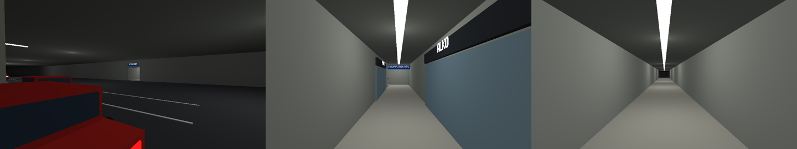

# Roadmap

Where 3D-auto is going, what's next, and what we've learned on the way. Written for whoever picks
up the work next, human or model. The main README describes how things work today. This file says
what to build next and why.

## The goal

The long-term goal is a GTA-style game that can be built for **any real city from open data**.
Raisio, Finland is the testbed because Oliver lived there for 20 years and can say what's right
and what's off. It is not the end product.

Targets after Raisio, roughly in order of difficulty:

- **Turku**: the next city over, and Oliver's home town now.
- **1:1 Manhattan**: about 60 km², dense, a grid, with tall buildings.
- **Helsinki**: combines Raisio's problems (terrain, Finnish streets, sea) with Manhattan's
  (density, size).

Everything built for Raisio should be generic and driven by map tags, in `tools/osm_import.py`
and `game/lib/roadnet.lua`. Raisio-only facts belong in `game/maps/raisio*.lua`.

## Where things stand (October 2026)

- The release line is **Aurajoki** (`aurajoki-v0.9.x`) with Raisio and Turku. Brands in the
  game are Finnish parodies (Häsburger, Pöli, Puskuri, Vicklund, Verkkari Stadion, Lumis).
- Turku at real size: OSM roads and buildings on 2 m MML LiDAR terrain; the Aurajoki with its
  bridges (decks level with their streets and arched over what passes under), boats and the
  Föri; covered tunnels (Myllyahde, Helsinginkatu); hand-made slices for Kauppatori, Vanha
  Suurtori and Tuomiokirkko, Kakolanmäki, Portsa, Turun linna, the harbour, Kupittaa and
  Yliopistonmäki. Raisio is about 8 × 8 km on the 10 m elevation model, one corridor away.
- **Missions on templates** (`docs/MISSION_TEMPLATES.md`): seven missions cast their places
  from the map's real points of interest by seed, so each run is another version (a real
  Hesburger, banks, garages, landmarks, pubs, marinas).
- **Free roam**: traffic of cars, vans, taxis and sports cars, Föli buses, pedestrians, police pursuits with roadblocks from three
  stars and a helicopter from four, Lumis cash vans to rob, street racers at night, street lamps that knock over, weather (clear, cloudy, rain,
  storm; snow in winter) with wet and snowy roads, and a city radio that answers what you do.
- **Side jobs and finding your way**: a GPS line on the radar to whatever you're after, a
  waypoint you set on the map (M), a radar that turns with you, taxi fares, ambulance calls,
  vigilante shifts, fires, Pöli bus routes and a police convoy at four stars. The jobs pick
  their places like the missions do (real hotels, pitches, bars, hospitals), by the hour.
- **Turku's look from open data**: roof and ground colours from the city's 2022 aerial photo,
  measured heights and LOD2 roofs from its 3D city model, procedural facades (old town,
  flats, glass, new) with lit windows at night, painted crossings, traffic lights that cycle,
  Föli shelters at the real stops, and low/medium/high quality presets in settings.
- **Phone**: the browser build (GitHub Pages) plays with touch controls, saves and sound.
- **Sweeps that drive the whole map** keep it playable: traffic (`DRIVE_SWEEP`), buses,
  pedestrians (`PED_SWEEP`), the player's car (`PLAYER_SWEEP`), bridges (`BRIDGE_AUDIT`), and
  landmark renders checked by pixel in CI.
- **Performance:** `PROFILE=1` prints fps, Lua, physics and draw time and the worst frame;
  `PROFILE_DRIVE=1` drives a robot round town. Turku headless peaks at about 540 MB RSS (it
  was 1.2 GB; vertices are 20 bytes now). On the Beelink's Radeon 890M the GPU takes 2-4 ms a
  frame at 1080p: it is not the limit.

## Learned in October 2026

- Lua's generational collector is worse here, not better: the heap drops from 215 to 84 MB,
  but a full collection stopped one tick for 210 ms. The default incremental one had one
  32 ms tick in two minutes of driving Turku. Hot code should still not make a table per
  item: a route search with one did run into a 104 ms collection step.
- The robot drivers (`test/robot.lua`) cut corners: at Hämeensilta's 87-degree slip road
  they meet the railing that keeps cars off a 7 m drop. Slowed down, it's drivable. Tests of
  a job tow the robot on after 12 s stuck, and print where.

## Done from the old list

- Every landmark has a render check in CI (`tools/test_landmark_renders.py`).
- Vertices packed to 20 bytes; memory roughly halved.
- The Gemini review's items: each vehicle class has its own pull and top speed (bus ~75 km/h),
  spot lights fade softly to their edge, the clock is 48 minutes a day, the help box shows on
  the first run only, and losing the cops takes time out of sight scaled by stars.
- The story catalogue and scorer (`lib/story.lua`, `story/radio.lua`).

## Done 27-28 October 2026

- Waves 0 and 1: these docs, postcard renders before and after (`tools/postcards.py`), the
  phone's low preset, mall and works facades, gulls and bells, parody adverts, the CI flakes.
- Wave 2, buildings: cornices and floor lines, shop signs from OSM `shop=*`, balconies. Not yet:
  LOD2 roofs beyond the old town, Ylioppilaskylä (both wait for the playtest).
- Wave 3, streets: stop lines and edge lines, worn and patched asphalt, setts on the old lanes,
  cycle paths you can see (painted bicycles, a line down the segregated ones, the squares of cycle
  crossings). Not yet: lane arrows (the importer doesn't export `turn:lanes`).
- Wave 4, life: cyclists, people at the shelters boarding the buses, market day on Kauppatori,
  terraces along the river, crowds outside the bars at night (every night: the game has no days
  of the week).
  - **Kauppatori Torikahvila & Stalls (`systems/city_life.lua`):** Traditional orange-and-cream striped
    canvas market pavilion on Kauppatori with valance signage (`TURUN TORIKAHVILA`), pine counter with
    steaming coffee urns, posliinikupit, pastry display case with fresh possumunkkeja, chalkboard menu,
    and 4 picnic tables with morning coffee patrons. Interactive purchasing (`R`: *Kahvi & possumunkki*
    $5, +35 HP; `E`: *Lihapiirakka kahdella nakilla* $6, +45 HP) with custom synthesized audio (`torikahvi`,
    `possumunkki`), open 06:00-18:00. Fast-purchase produce stalls (mansikat, herneet, uudet perunat, ruisleipä).
  - **Aurajoen Jokilaivat (`systems/city_life.lua`):** Flagship floating restaurant vessels along Aurajoki quays:
    **Svarte Rudolf** and **Donna** on Itäinen Rantakatu, **Majland** on Läntinen Rantakatu. Moored on surveyed
    river water with walkable Layer 0 timber gangways (kulkusillat) connecting stone quays to solid boat decks
    (`tag = "deck"`, `body = "static"`). Solid decks with perimeter railings and gangway boarding gates, shaded
    canopies, round tables with parasols, seated patrons, and bar counters with beer taps and chalkboard menus.
    Bartender NPCs (Rudolf, Donna, Matti) with interactive orders (`R`: *Aura-olut* $6, +25 HP; *Donna Special* $7,
    +30 HP; *Majland-IPA* $6, +25 HP; synth audio `jokilaiva_drink`). Warm festoon fairy string lights illuminating
    from dusk through the night (16:00-04:00).
  - **River Safety Integration (`systems/shore.lua`):** Downward raycasts identify boat, deck, and ferry tags
    (`deck`, `ship`, `ferry`, `boat`), allowing walking and standing on floating restaurant ships and gangways
    without triggering water resets.
- Wave 6 begun before the playtest: businesses to buy (`systems/businesses.lua`) and a story
  through the missions (`story/arc.lua`), both first drafts for the playtest to tune.
- Wave 7 begun: big meshes go to the GPU as they're made and the CPU copy is dropped (the browser's
  peak on Turku 583 -> 353 MB); building walls stream in by 300 m chunk near the player; in the
  browser the collector keeps up while the city loads. The browser's number is CI's `web-check`
  artifact (`wasm_peak_bytes`), and `tools/web_check.py` gives the same number locally.
- The playtest itself: `docs/PLAYTEST.md`.

## Visual pass against the real city (November 2026)

`tools/reference.py` renders the game straight down over a square and puts it next to the
city's 2022 aerial photo of the same square, and the two blended: a missing building, a
street off its line or a park without its trees shows at a glance. First findings, worst first:

1. **Trees.** The photo's parks, banks and yards are full of canopy; the game had a few
   thousand small trees. Now the importer finds about 118,000 under the photo's canopy, each
   its crown's size, with trunks off the roads, paths, buildings and water, into
   `maps/turku_trees.bin` (10 bytes a tree). The engine holds them and bakes the standing ones
   into 200 m chunk meshes (`engine.forest`, one draw a chunk, 26 vertices a tree); low/medium/
   high quality stand about 27k/73k/118k. They cast no sun shadow (a crown's would be a black
   disc; the photo's dark canopy under them is now shaded grass instead). Trunks near the
   player are a pool of invisible bodies moved about (`systems/trees.lua`), so a car still
   stops at a tree. `tools/test_trees.py`.
2. **Ground.** The 10 m colour grid is blotchy from above and ponds, pitches and playgrounds
   come out in steps. Done: the ground map below.
3. Smaller: white slivers at some building feet. (The tree crown in a wall below Myllysilta
   was one of `systems/aurajoki`'s hand-placed river trees; the photo's trees replace them.)

### The ground map (November 2026)

The terrain's colour points are 10 m apart, so a yard blurs into a blotch and a pitch knows
only its edges' height lines. The importer now writes a second file next to the map,
`maps/turku_ground.bin`: the aerial photo's ground every **2 m** (3161 x 3046 points, 52 -> 36
colours), with the photo's shadows lifted (the game lights the ground itself), shaded lawn
under the photo's crowns (the game draws the trees), and the survey's crisp grounds — pitches,
courts, tracks, sand — in their own colours, as the terrain's points have them. A palette and
an index a point (runs, and a run "as the row above"), so the file is 3.6 MB; the engine
uploads the index and the palette as two textures, then drops the points again (in the browser
they'd be held for nothing). One class (66) in the terrain's shader takes its colour from the
map. `tools/ground_map.py`, `tools/test_ground_map.py`, Rust's `Engine::load_ground_map`.

### Street level against the laser scans (November 2026)

`tools/lidar.py` brings in Maanmittauslaitos's airborne laser scans of Turku (spring 2021 and
summer 2023, about a point a square metre; nothing denser exists for Turku, with or without an
API key), and `tools/reference.py --street` renders each postcard twice from the same camera:
the game, and the scans' ground, roofs and crowns coloured from the aerial photo. Heights and
street shapes match within a metre. What it found:

- **Building heights.** 768 of the big boxes were over 6 m too tall: the city model has some
  heights over the sea, not the ground (a two-storey house of 1935 at 43.9 m on a hill 35 m
  up), which stood as thin towers in the suburbs. The importer now checks every box against the
  scans' roofs (1026 lowered, 272 raised) and, where there are no scans, against its storeys.
  Too tall by 6 m: 768 -> 39; too low: 103 -> 62 (mostly churches' spires and decks over roads,
  left alone).
- **Cars thrown into buildings.** Two traffic cars turning into each other at a junction got
  a metre and a half into each other, and the physics pushed them apart at 18 m/s, two metres
  up and into a wall. The push out of an overlap is now capped at 4 m/s (`MAX_PUSH`).
- Turun taidemuseo is a `flats` box: it should be a landmark of its own.

### Föli's real lines (November 2026)

Traffic's buses used to wander like any car. `tools/foli_lines.py` takes Föli's timetable
data (GTFS, CC BY 4.0) and matches each line's busiest route onto the map's own streets
(162 of 164 line directions in Turku), into `maps/turku_bus.lua`: the junctions in order. A
bus now drives the rest of the line whose street it's put on (or is moved to the nearest line
street), with the line and destination on its boards (`lib/buslines.lua`). Re-run the tool
after importing Turku again: `tools/test_buslines.py` fails if a line names a junction the map
no longer has. Nothing is fetched while playing.

### Places by name (November 2026)

Shops' signs say what they are (KAHVILA, PARTURI); a place the town knows by its own name has
that up instead: about 390 in Turku, its bars, pubs, restaurants and cafés that aren't a
chain's, its schools, colleges, theatres, cinemas, museums and hotels, and the places known
beyond their street (a Wikidata entry in OSM: Forum Marinum, Proffan kellari, Uusi Apteekki).
A long name goes on two lines, and slides along its own building for a wall that faces the
street and has room. `game/test/shopsigns_probe.lua` keeps a list of the places Oliver asked
for by name (Luostarivuoren lyseon lukio, EduCity...); add to it. Balconies are on homes only
now (not schools or police stations), and signs keep clear of them.

### Stairs (November 2026)

Oliver's chase on foot: from Kauppatori through Puolalanpuisto, down the stairs to Louhi's
entrance, over Logomonsilta and into Logomo to lose the cops. The first piece: OpenStreetMap's
outdoor stairs (not indoors, roofed, on a bridge or inside a building) are built as steps
from the ground at one end to the ground at the other, with handrails where mapped, and an
unseen ramp under them so running up is smooth. 389 of Turku's 948 are built; the rest are on
ground the 10 m terrain sees as level (a door's few steps). `STAIRS_TEST=1`
(`tools/test_stairs.py`) runs up and down Puolalanportaat and the tallest flights. Still to
do for the route: somewhere in Logomo to hide. Louhi's entrance is there now
(`systems/landmarks.lua`): a concrete portal in a granite face at the foot of the stairs,
LOUHI over it, the 2.2 m height bar and a blue P; not open (the hill is solid ground).

### Logomonsilta (November 2026)

The footbridge from the station to Logomo as it is (Oliver's photo): a glass tube on a dark
frame over the railway yard, black stair and lift towers, a glass box at the station end, and
black-roofed stairs down from both ends and to the three platforms
(`systems/landmarks.lua`, from OpenStreetMap's ways; `maps/turku.lua` leaves out the generic
footbridge and the two tower boxes). You can run over it: `LOGOMONSILTA_TEST=1`
(`tools/test_logomonsilta.py`) crosses both ways and goes down to a platform.

### Hiding in Logomo (November 2026)

The end of Oliver's chase on foot: wanted, walk in through Logomo's door (just past the foot of
Logomonsilta's stairs, `systems/hideouts.lua`) and you're inside, where the cops and the
helicopter can't see you and they can't bust you. Gone in unseen, they lose you as if you'd
left their search area (`wanted.escape_time`, 3-25 s); if a cop saw you go in (in the last
1.5 s), they wait you out (`wanted.give_up_time`, 30-70 s). Move to come back out by the door.
`HIDEOUT_TEST=1` (`tools/test_hideouts.py`). Other hideouts: add a {name, from, to} to SPOTS.
### Courtyards (November 2026)

A building mapped with courtyards (a multipolygon's inner rings over 40 m²) has them open:
`tools/osm_import.py` cuts each into its outline as a keyhole (round the outside, a slit in,
round the yard the other way, back out), so its roof has the hole and its boxes leave the yard
clear. Ylioppilaskylä's Tyyssija (the zigzag by Ikituuri) and Aitiopaikka (the oval) were
solid blocks. Passages through to them (`tunnel=building_passage`) are doorways in the walls
(`mesh::prism_doors`), a dark lining door to door, and the building's boxes split either side,
for buildings drawn as their outline (152 in Turku); `PASSAGE_TEST=1` walks Tyyssija's and
Aitiopaikka's. Aitiopaikka's lower block inside its yard isn't in OpenStreetMap.

### Layers, for underground places (November 2026)

The first piece of docs/UNDERGROUND.md (Louhi, Hansa's lower floor): every entity and light
has a `layer`, 0 the street. Bodies only meet bodies in their own layer, the terrain is only
in layer 0 (so a cave can sit under the hill without the ground pushing its cars up), rays
only see one layer, and only the camera's layer (`engine.view_layer`) is drawn. From Lua:
`spawn{layer = 1}`, `light{layer = 1}`, `engine.set_layer(id, l)`, `engine.layer(id)`,
`engine.view_layer([l])`, and `engine.raycast(..., ignore, layer)` (by default the ignored
entity's layer, or 0; -1 for every layer). `LAYERS_TEST=1` (`tools/test_layers.py`).
Louhi uses it (below).

### Louhi, drivable (November 2026)

Piece 2 of docs/UNDERGROUND.md: drive through the portal on Ajurinkatu and you're in Louhi
(`systems/louhi.lua`, layer 1): the 363 m tunnel where OpenStreetMap has it, down at 2.5 % to
the hall under Kauppatori's west end (195 x 35 m, level -2, its floor at y 2), with rows of
bays, a third of them with parked cars, pillars, lit strips and lamps. Underground the sky
goes dark (`Env::indoors`). Back out through the portal, you're up in the street again.
Wanted, it's GTA's tunnels: cops up top make for the portal and follow you down, keep to the
tunnel and then the hall; the helicopter can't see you; a cop on Kauppatori over your head
isn't "next to you". `LOUHI_TEST=1` (`tools/test_louhi.py`): in, round the hall, out of the
car and back, out; then at two stars a cop follows you down, and at four the helicopter comes
over and never sees you. Polish left: 2.4 m like the real one (4 m now, for the camera), the
second level, Toriparkki, the foot exits (pieces 3-5).

### Louhi on foot, up to Kauppatori (November 2026)

Piece 3 of docs/UNDERGROUND.md: Louhi's stair house on Kauppatori's west end (OpenStreetMap
way 1034479364) has its door where OSM has it, on the west side, LOUHI and the blue P over it.
Walk through it and you're on a landing at street height, stairs down beside the hall's far
wall to a door into the hall, KAUPPATORI over it; back up the same way and out onto the square.
Wanted, officers on foot follow you through the door and down the stairs (or back up). Cop cars
still come the long way, through the portal on Ajurinkatu. `LOUHI_FOOT_TEST=1`
(`tools/test_louhi_foot.py`): down from the square into the hall and back out, never through
the stairs; at two stars an officer on the square follows you down.

### Hansa's lower floor (November 2026)

Piece 4 of docs/UNDERGROUND.md (`systems/hansa.lua`): out of Louhi's hall at its west end
on foot, a corridor to Hansa's level -1, along it past the shops (Stadium, Partioaitta and the
lifts where OpenStreetMap has them along it; the rest unnamed), up the stairs where OSM has
them to the ground floor and out the door on Aurakatu (Hansa Aurakatu 12a), HANSA over it.
Back in the same way. Louhi's doors, floors and ways on foot are now lists (`louhi.DOORS`,
`AREAS`, `ROUTES`) that Hansa adds to; officers follow any route through its door and along
it. `HANSA_TEST=1` (`tools/test_hansa.py`): from the hall out onto Aurakatu and back down,
never through a floor; at two stars an officer on Aurakatu follows you in and down to Louhi.

### Toriparkki, joined to Louhi (November 2026)

Piece 5 of docs/UNDERGROUND.md (`systems/toriparkki.lua`): the car park under Kauppatori's
east half, where OpenStreetMap has it (way 1207799675): a 120 x 123 m body in eight aisles of
bays with pillars and parked cars, an arm out to its own ramp (way 1035382220), and up the ramp
to the street east of the square, TORIPARKKI and a 3,0 m bar over the mouth. From Louhi's
hall, a way through its east end (the game's, 11 m wide) round into the arm. Louhi's portals,
zones and the cops' way between them are now lists (`louhi.PORTALS`, `ZONES`, `ORDER`, `LEAVE`,
`WITHIN`): cops come in through whichever way in is nearer you and drive zone by zone to you.
Underground, they know you're down there: you can't get outside the search circle by driving
far from the way in, only wait for them to give up or come up somewhere else. Floors down here
are `ground`, not `wall`, so driving onto one isn't a crash. `TORIPARKKI_TEST=1`
(`tools/test_toriparkki.py`): from Louhi's hall through the link, up the ramp into the street
and back down to the first aisle; at two stars a cop car comes down the ramp to you.

### Louhi as it looks (November 2026)

From Oliver's photos of the real Louhi: the walls are the rock, sprayed and painted white, bumpy,
leaning in where they meet the dark open ceiling (ducts, cable trays, the rows of strip lights);
a low kerb along them, a red rail at hip height with red extinguisher boxes. At the way in from
the tunnel, the striped height beam, red bollards and the dark sign with P1, the free places in
green (`louhi.free_bays`) and a 20 at each end; green ULOS signs over the doors on foot. All
drawn only (`louhi_tunnel_look`, `louhi_hall_look`: nothing new to hit), laid out by a hash of
the place. `SHOT_LAYER=1` renders underground (`game/test/shot.lua`).

### Louhi's cars come and go (November 2026)

While you're down in Louhi (`systems/louhi_life.lua`), three of its parked cars take turns: one
backs out of its bay (swinging round to face the way it's going), drives round to the tunnel and
away up it; out of your sight it's gone, and later comes back down as someone new, drives round
the aisles looking for a space and parks, nose in. They stop for you, cops and each other, never
come down the tunnel while you're in it, and nobody leaves while you're wanted. The P1 sign's
green number is the free bays as they are. Only cars made at load are moved (never spawned in
play) and every choice is a hash, so traffic up top plays out as before. `LOUHI_LIFE_TEST=1`
(`tools/test_louhi_life.py`): six minutes standing in a bay; cars back out, leave, come back and
park, none gets stuck or tips, nobody drives into you, the sign is right all along.
### Toriparkki on foot, from the pavilions (November 2026)

From Oliver's map of Toriparkki's ways on foot: the stairs down are in three of the square's
pavilions, A (Aurakatu's), B (Eerikinkatu's) and C (Kauppiaskatu's), their doors where
OpenStreetMap has them (`toriparkki.UNITS`), in the wall of OSM's footprint that faces the middle
of the square: TORIPARKKI A and the blue P over each. Through the door, a landing, a flight down
and a landing at the bottom open to the car park, A KAUPPATORI (B, C) over it. The square is
about as high as the car park's ceiling, so each is a walled box where it takes least room
(A in the west end's cross aisle, B and C in bays, with 6 m kept clear beside them); the car
park's ceiling has holes over them. Officers follow you down any of them. Floors over floors:
`louhi.area_floor(x, z, margin, y)` takes a height. `TORIPARKKI_FOOT_TEST=1`
(`tools/test_toriparkki_foot.py`): down and back up each of A, B, C, never through a step;
at two stars an officer on the square follows you down B. Not yet: the ways under the streets
to Hansa, Wiklund and Forum/KOP-kolmio on the map.

### Toriparkki's ways under the streets (November 2026)

The rest of Oliver's map: from the car park, ways on foot under the streets to its neighbours,
where OpenStreetMap's layer -1 stubs leave it. South under Eerikinkatu (FORUM  KOP-KOLMIO over the
way in) to stairs up to Forum's staircase door on Eerikinkatu; east under Kauppiaskatu (WIKLUND),
past Prisma's and Alko's fronts (Wiklund's level -1 in OSM), to stairs up to Wiklund's door on
Kauppiaskatu; west under Aurakatu (HANSA) and round into Hansa's level -1, so you can walk from
the car park through Hansa and out on Aurakatu. Each far door has TORIPARKKI and the blue P over
it up top. Officers follow you down any of them. The stairs at the far ends are #261's boxes, now
going either way (`toriparkki.UNITS`: `dir`); the ways are `toriparkki.WALKS`, open into the car
park through gaps in its walls (`BODY_GAPS`) and into Hansa through `louhi.HANSA_LINK`.
`TORIPARKKI_FOOT_TEST=1` now also walks in at Forum's and Wiklund's doors along the ways into the
car park and back, from the car park to Hansa and out on Aurakatu, and has an officer follow you
down through Wiklund.

### Turun Kauppahalli, walkable interior (November 2026)

Piece 6 of docs/UNDERGROUND.md (`systems/kauppahalli.lua`): Turku's historic Market Hall (1896)
between Eerikinkatu and Linnankatu (`center = {-215.2, 195.5}`, OSM building 24911). On layer 0,
authentic red-brick arched portals with decorative stepped gables, "TURUN KAUPPAHALLI" and
"ANNO 1896" signs, timber-framed glass doors, and brass lanterns mark both street entrances.
Step inside and transition seamlessly to layer 1: a 112 m long, 15.4 m wide interior hall at
`y = 4.80`, complete with checkerboard tile flooring, arched timber roof trusses, central
clerestory skylight, pendant bronze lamps, and 12 authentic market stalls (Kahvila Halli, Leipomo Juuri,
Kalaliike Virtanen, Turun Juustopuoti, Piirakkapaja, Herkku-Keitto, etc.) with readable signboards,
shopkeeper NPCs behind counters, and browsing shoppers. Press `R` at food stalls to heal HP and buy
food/drink ($4-$10). Entering breaks police line of sight and marks `wanted.hiding = true`.
Radar icon `"H"`. `KAUPPAHALLI_TEST=1` (`tools/test_kauppahalli.py`).

### Uusi Apteekki, iconic pub interior (November 2026)

Piece 7 of docs/UNDERGROUND.md (`systems/pub.lua`): the legendary 1907 apothecary pub on
Kaskenkatu 1 (`DOOR_X = 49.9, DOOR_Z = 428.9`). On layer 0, a rusticated stone arch facade with
heavy timber door, dark green and gold "UUSI APTEEKKI" sign, double-sided hanging "PUB" blade sign,
sidewalk chalkboard, and brass coach lanterns. Crossing the threshold enters layer 1 at `y = 12.68`
(matching Kaskenkatu slope): 12 x 10.4 m interior with dark parquet floor, vintage apothecary green
wainscotting, the signature 32-drawer wooden apothecary cabinet wall with rows of glowing elixir bottles,
mahogany bar counter with brass beer taps, glassware, footrail, 4 bar stools, and 3 candlelight pub
tables. Bartender Olli and regular patron NPCs. Press `R` at the bar to buy an Apteekkari-IPA ($7,
+35 HP, drinking sfx); press `R` at the wall dartboard to throw darts with authentic thud sfx and score
popups (bullseye, triple 20, etc.). Wanted evasion and radar icon `"B"`. `PUB_TEST=1`
(`tools/test_pub.py`).

### EduCity, Turku AMK at Kupittaa (November 2026)

EduCity (Joukahaisenkatu 7, 2020) was a dark glass box like any new office. Now its walls are
the light grey of its handmade Kolumba tiles: an outline's look (`map.outline_looks`) can set
its `wall` colour and its `facade` by name. Inside (`systems/educity.lua`, layer 1 as the
Kauppahalli), from the glass door on Joukahaisenkatu: the atrium under its printed-glass
skylight, galleries every floor with wooden "dice" jutting out, the Stairway of Skills down
from the foyer to the restaurant (timber steps to sit on, a ramp underfoot), and a hackathon
at long tables of laptops on the atrium floor with a big screen and pizza. Coffee in the foyer
($3), lunch downstairs ($9), the hackathon's pizza free; inside the cops lose sight of you. A
glass bridge joins it to ICT-City over the campus street. From Arkkitehti 1/2021; the exact
look waits for photos. `EDUCITY_TEST=1` (`tools/test_educity.py`) walks in by the door and
down the stairs. Postcard spot `educity`.

## Next (agreed with Oliver, 27 October 2026)

The game has more features than reasons to play them, and Turku is recognisable from above
but not yet from the street. So: make it look like Turku where you stand, make it feel alive,
then give the player something to work towards. In order:

0. **Groundwork.** These docs up to date, and **postcards**: fixed camera spots rendered
   before and after every visual PR, so a change is judged by looking. The spots: Ylioppilaskylä,
   the Aurajoki riverside, Kauppatori, Kakolanmäki, the Logomo railway yard, Puolalanmäki
   (the art museum and Puolalanpuisto) and Kupittaa (campus and park).
1. **Small wins.** The phone picks the low preset by itself (`engine.platform()`); pedestrians
   stop scanning every entity for `engine.nearest`; windows on malls and warehouses; the CI
   tests that flake on slow runners; sounds of the place (gulls by the river and the harbour,
   the cathedral's bells on the hour); Turku parody adverts.
2. **Buildings.** Cornices and floor lines, shop fronts from OSM `shop=*` (window, light,
   parody sign), balconies on the flats, LOD2 roofs beyond the old town, Ylioppilaskylä's
   unusual shapes.
3. **Streets.** Lane markings, stop lines and arrows; worn and patched asphalt; cobbles in the
   old town; cycle paths you can see.
4. **Life.** Cyclists, people who wait at the shelters and board the bus, stalls and crowds on
   Kauppatori by day, terraces along the river in summer, Aurakatu busy on weekend nights.
5. **Playtest** with Oliver, then tune the jobs (numbers at the top of `systems/fares.lua`,
   `ambulance.lua`, `vigilante.lua`, `fire.lua`).
6. **A reason to play.** Businesses to buy (a grill, a kiosk, a taxi firm) that pay while you
   play and are places to save, and a story that ties the eleven missions together through the
   radio and its characters.
7. **Phone for real.** Load Turku in pieces around the player instead of all 52,000 entities
   at once (the browser build is about 530 MB). The Raisio-Turku crossing waits for this.

### Later

- Helsinki, then 1:1 Manhattan.
- A small classifier behind the story scorer, only once the catalogue needs it.

## Data sources

| What | Where | Notes |
|---|---|---|
| Roads, buildings, land use | OpenStreetMap via Overpass | ODbL. Fetch in tiles (`osm_import.py --fetch`); public servers time out on whole towns. |
| Terrain | Maanmittauslaitos elevation model, 10 m (2 m available) | CC BY 4.0. Key in `~/.config/3d-auto/mml-key`. |
| Building heights and roofs | Turku's 3D city model (LOD1 everywhere, LOD2 in the centre) | CC BY 4.0. Used. |
| Roof and ground colour | Turku's 2022 true orthophoto (city WMS) | CC BY 4.0. Used. |
| Bus lines | Föli's GTFS timetable data (data.foli.fi) | CC BY 4.0. `tools/foli_lines.py`, cached in `tools/osm_cache/foli_gtfs.zip`. |
| Helsinki | City of Helsinki's open 3D city model | Not used yet. |
| Manhattan | NYC Open Data building footprints with heights | Not used yet. |
| Google Earth 3D | — | **Off limits:** its terms don't allow pulling its models into a game. |

## How to work on this repo (lessons learned)

- **Test like CI before every push.** Run the full suite:
  `python3 tools/headless_tests.py --output <dir> --jobs 3 --soak` (all maps, all seeds), plus
  `--maps starter`, `--maps raisio` and `--maps turku` with `--seeds 1337`, plus
  `cargo fmt --check`, `cargo clippy --release -- -D warnings`, `cargo test --release`, and
  `python3 -m unittest discover -s tools -p "test_*.py"`.
- **Maintain PRNG determinism:** keep `math.random` calls consistent across vehicle spawns so
  soak tests don't desynchronize between seeds.
- **Check visuals by looking at pixels.** Probes like `KAKOLA_TEST` only prove an entity exists. In
  v0.9.1, Kakola rendered black, Kauppatori's paving was half under the hillside, and Turun linna
  stood on a road, all with green CI. Run `RENDER_CHECKS=1 python -m unittest
  tools/test_landmark_renders.py`, and look at the frames yourself. The older
  `tools/*_render_checks.py` only check that a PPM file was written.
- **Place landmarks from the map data, not by eye.** Compute the position from latitude and
  longitude with the map's `origin`. Filter the OSM boxes the prefab replaces (see `maps/turku.lua`).
- **Nothing hand-placed goes on a carriageway.** Check every tree, lamp, bench and wall with
  `roadnet.on_carriageway` (or move it with `roadnet.off_carriageway`). The Aurajoki promenade put
  208 of them on Turku's streets. `tools/test_road_clear.py` keeps the count at zero.
- **A look's colour multiplies the mesh's.** Mesh walls that a look colours must be white.
- **PRs run the seed-1337 smoke test only.** The full seed suite runs after merge, so run it
  locally before merging.
- **Fewer, checked PRs beat many fast ones.** 79 PRs in four days meant no one looked at a frame
  before merging.
- Never pop open GUI windows on the host desktop without permission.
- **Always branch fresh from `origin/main`** after every merge and delete merged branches immediately.
